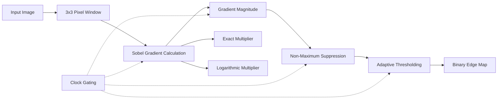

# FPGA-Based Sobel Edge Detection Accelerator

<p align="center">
  <h2 align="center">Sobel Edge Detection Accelerator on FPGA</h2>
  <p align="center">
    Hardware implementation of an enhanced Sobel edge detector with
    Non-Maximum Suppression (NMS), adaptive thresholding, clock gating,
    and Exact vs. Logarithmic multiplier comparison.
  </p>
</p>

---

## Table of Contents

- [1. Project Overview](#1-project-overview)
- [2. Motivation](#2-motivation)
- [3. Main Objectives](#3-main-objectives)
- [4. Target Hardware](#4-target-hardware)
- [5. System Architecture](#5-system-architecture)
- [6. Processing Pipeline](#6-processing-pipeline)
- [7. Sobel Edge Detection](#7-sobel-edge-detection)
- [8. Non-Maximum Suppression](#8-non-maximum-suppression)
- [9. Adaptive Thresholding](#9-adaptive-thresholding)
- [10. Exact vs. Logarithmic Multiplier](#10-exact-vs-logarithmic-multiplier)
- [11. Clock Gating and Power Optimization](#11-clock-gating-and-power-optimization)
- [12. Visual Results](#12-visual-results)
- [13. Effect of NMS and Adaptive Thresholding](#13-effect-of-nms-and-adaptive-thresholding)
- [14. Verification and Simulation](#14-verification-and-simulation)
- [15. Waveform Results — `tb_SobelFilter`](#15-waveform-results--tbsobelfilter)
- [16. Waveform Results — `tb_SobelImage`](#16-waveform-results--tb_sobelimage)
- [17. Vivado Implementation Flow](#17-vivado-implementation-flow)
- [18. Current Implementation Status](#18-current-implementation-status)
- [19. FPGA Hardware Validation](#19-fpga-hardware-validation)
- [20. Results and Metrics](#20-results-and-metrics)
- [21. Repository Structure](#21-repository-structure)
- [22. Future Work](#22-future-work)
- [23. Author](#23-author)

---

# 1. Project Overview

This project implements an **FPGA-based Sobel edge detection accelerator** designed for real-time image-processing applications.

The baseline Sobel operator is extended with two additional image-processing stages:

1. **Non-Maximum Suppression (NMS)** for edge thinning and localization.
2. **Adaptive thresholding** for improved separation between significant edges and weaker/noisy responses.

The hardware architecture also incorporates:

- **Clock gating** for reducing unnecessary switching activity.
- An **Exact multiplier** implementation.
- A **Logarithmic multiplier** implementation for comparative approximate-computing analysis.
- RTL simulation and functional verification.
- Vivado synthesis and implementation.
- Timing analysis and FPGA resource analysis.
- Final deployment targeting the **Digilent Nexys 4 DDR**, based on the Xilinx Artix-7 FPGA.

The project is intended not only as an implementation of Sobel filtering, but also as a study of the trade-offs between **image quality, hardware complexity, timing, and power consumption**.

---

# 2. Motivation

Edge detection is a fundamental operation in computer vision and image processing. It is commonly used as an early-stage operation in:

- Object detection
- Image segmentation
- Feature extraction
- Machine vision
- Robotics
- Medical imaging
- Surveillance systems
- Embedded vision
- Autonomous systems

Software implementations are flexible, but FPGA implementations can provide highly parallel and deterministic processing with low latency.

The main objective of this project is therefore to implement the edge-detection pipeline directly in RTL and evaluate how architectural choices affect:

- FPGA resource utilization
- Timing
- Power
- Edge-map quality
- Hardware complexity

A particular focus is placed on comparing an **Exact multiplier** with a **Logarithmic multiplier**.

---

# 3. Main Objectives

The project has the following objectives:

### Functional objectives

- Implement Sobel edge detection in synthesizable Verilog RTL.
- Generate horizontal and vertical image gradients.
- Calculate gradient magnitude.
- Refine detected edges using Non-Maximum Suppression.
- Apply adaptive thresholding.
- Produce a binary edge map.

### Hardware objectives

- Implement the complete pipeline for FPGA operation.
- Target the **Nexys 4 DDR** development board.
- Maintain operation at a target clock frequency of **100 MHz**.
- Close timing successfully in Vivado.
- Minimize unnecessary switching activity through clock gating.

### Research objectives

- Compare Exact and Logarithmic multiplier implementations.
- Evaluate resource utilization.
- Evaluate power consumption.
- Evaluate timing performance.
- Compare resulting edge-map quality.
- Determine the practical trade-off between computational approximation and hardware cost.

---

# 4. Target Hardware

## FPGA Development Board

**Digilent Nexys 4 DDR**

The design targets the Xilinx Artix-7 FPGA used on the Nexys 4 DDR development board.

### Target device

- FPGA family: **Xilinx Artix-7**
- Device used during Vivado analysis: **XC7A100T**
- Package: **CSG324**
- Speed grade: **-1**
- Target clock: **100 MHz**
- Clock period: **10 ns**

The final hardware validation will be performed by programming the generated Vivado bitstream onto the physical Nexys 4 DDR board.

---

# 5. System Architecture

The accelerator can be conceptually represented as the following pipeline:



The two multiplier configurations are evaluated as separate hardware implementations:

```text
                    +----------------------+
                    |     Input Image      |
                    +----------+-----------+
                               |
                               v
                    +----------------------+
                    |  Pixel Window /      |
                    |  Neighborhood Logic  |
                    +----------+-----------+
                               |
                               v
                    +----------------------+
                    |   Sobel Gradients    |
                    |       Gx / Gy        |
                    +----------+-----------+
                               |
                  +------------+------------+
                  |                         |
                  v                         v
        +------------------+       +------------------+
        | Exact Multiplier |       | Log Multiplier  |
        +--------+---------+       +--------+---------+
                 |                          |
                 +------------+-------------+
                              |
                              v
                    +----------------------+
                    | Gradient Magnitude   |
                    +----------+-----------+
                               |
                               v
                    +----------------------+
                    | Non-Maximum         |
                    | Suppression         |
                    +----------+-----------+
                               |
                               v
                    +----------------------+
                    | Adaptive Threshold   |
                    +----------+-----------+
                               |
                               v
                    +----------------------+
                    | Final Edge Map       |
                    +----------------------+
```

---

# 6. Processing Pipeline

The implemented processing chain is:

```text
Input Image
     |
     v
3x3 Neighborhood Generation
     |
     v
Sobel Gx / Gy
     |
     v
Gradient Magnitude
     |
     +-------------------------+
     |                         |
     v                         v
Exact Multiplier       Logarithmic Multiplier
     |                         |
     +------------+------------+
                  |
                  v
        Non-Maximum Suppression
                  |
                  v
        Adaptive Thresholding
                  |
                  v
          Binary Edge Map
```

Each stage has a specific purpose.

---

# 7. Sobel Edge Detection

The Sobel operator uses two 3×3 kernels to estimate the horizontal and vertical intensity gradients.

### Horizontal gradient

\[
G_x =
\begin{bmatrix}
-1 & 0 & +1\\
-2 & 0 & +2\\
-1 & 0 & +1
\end{bmatrix}
\]

### Vertical gradient

\[
G_y =
\begin{bmatrix}
-1 & -2 & -1\\
0 & 0 & 0\\
+1 & +2 & +1
\end{bmatrix}
\]

For a pixel neighborhood, the corresponding gradient responses are calculated as:

\[
G_x = \sum K_x(i,j)I(i,j)
\]

\[
G_y = \sum K_y(i,j)I(i,j)
\]

The gradient magnitude can then be represented using an appropriate hardware-friendly magnitude calculation.

The resulting gradient magnitude indicates how strongly the local image intensity changes.

Large changes generally correspond to image boundaries or edges.

---

# 8. Non-Maximum Suppression

The raw Sobel gradient contains more information than is normally required for a clean binary edge map.

A strong edge can occupy multiple adjacent pixels, resulting in:

- Thick edges
- Multiple responses around the same boundary
- Less precise edge localization
- Redundant edge pixels

**Non-Maximum Suppression (NMS)** addresses this by retaining a pixel only when it is locally maximal along the direction of the detected gradient.

Conceptually:

```text
Raw gradient response:

      █████
      █████
      █████

After NMS:

        █
        █
        █
```

NMS therefore attempts to reduce a broad gradient region into a thinner representation of the actual edge.

This is particularly useful for hardware edge detection because the output becomes more suitable for subsequent thresholding and feature extraction.

---

# 9. Adaptive Thresholding

After edge thinning, a thresholding stage converts the refined gradient response into a binary edge map.

A fixed threshold can perform poorly when image regions have different intensity distributions.

The implemented design therefore incorporates **adaptive thresholding**.

Conceptually:

```text
Gradient / NMS response
          |
          v
   Local / adaptive
      threshold
          |
          v
  +----------------+
  | Edge?          |
  |                |
  | YES -> 1       |
  | NO  -> 0       |
  +----------------+
```

The combination of NMS and adaptive thresholding helps produce an edge map containing fewer broad gradient regions and a more selective set of edge pixels.

---

# 10. Exact vs. Logarithmic Multiplier

One of the main experimental components of this project is the comparison between two multiplier architectures.

## Exact Multiplier

The Exact implementation performs the multiplication without deliberately introducing an approximation into the multiplication operation.

It serves as the **reference hardware implementation** against which the Logarithmic implementation can be compared.

The Exact design provides:

- Reference numerical behavior
- Reference edge-map output
- Baseline hardware utilization
- Baseline timing
- Baseline power estimate

---

## Logarithmic Multiplier

The Logarithmic multiplier uses a logarithmic/approximate arithmetic approach instead of conventional exact multiplication.

The motivation is to investigate whether multiplication can be performed with reduced hardware complexity while maintaining acceptable image quality.

The key research question is therefore:

> **Can logarithmic/approximate multiplication reduce hardware cost or power while maintaining an acceptable Sobel edge map?**

This is particularly relevant for image processing because small numerical errors in intermediate calculations may not necessarily cause visually significant degradation in the final edge map.

However, the final comparison must be based on measured FPGA implementation results rather than assuming that the logarithmic implementation is automatically smaller or lower-power.

---

# 11. Clock Gating and Power Optimization

Clock switching is a major source of dynamic power in synchronous digital circuits.

A register that receives a clock edge can potentially switch its internal state even when the corresponding processing stage does not need to perform useful work.

The design therefore incorporates **clock gating** to reduce unnecessary clock activity.

Conceptually:

```text
                Enable
                  |
                  v
Clock ---------->+------+
                       |
                       v
                 Gated Clock
                       |
                       v
                Processing Stage
```

When a processing stage does not need to operate, the gated clock can be disabled.

This can reduce:

- Clock-tree switching
- Flip-flop switching
- Dynamic power associated with inactive pipeline stages

The expected benefit is primarily a reduction in **dynamic power**, rather than static/leakage power.

This distinction is important:

\[
P_{total}=P_{static}+P_{dynamic}
\]

Clock gating primarily targets:

\[
P_{dynamic}
\]

rather than:

\[
P_{static}
\]

The effectiveness of clock gating therefore depends strongly on the activity pattern of the accelerator and on how frequently individual processing stages can remain inactive.

The design uses clock-gating logic in the RTL architecture rather than simply relying on the synthesis tool to infer power optimization automatically.

---

# 12. Visual Results

The following images show the progression from the original input through the baseline Sobel output to the enhanced outputs.

## 12.1 Original Input Image


**Figure 1 — Original input image**

The original image contains smooth regions, texture, illumination variations, object boundaries, and fine details. These characteristics make it useful for demonstrating the effect of edge detection and subsequent edge refinement.

---

## 12.2 Sobel Output Without NMS


**Figure 2 — Baseline Sobel edge output without NMS**

The baseline output contains a large number of edge responses.

Compared with the refined results, the output is noticeably:

- Thicker in several regions
- More densely populated with white pixels
- More redundant around strong boundaries
- Less selective in representing a single edge location

This is a typical characteristic of an edge map before edge thinning and more selective thresholding.

---

## 12.3 Sobel + NMS + Adaptive Threshold — Exact Multiplier


**Figure 3 — Enhanced Sobel output using NMS + adaptive thresholding with Exact multiplier**

The enhanced Exact implementation produces a substantially thinner and more selective edge map.

Major structures such as:

- Hair boundaries
- Facial features
- Clothing contours
- Arm boundaries
- Object silhouette

remain visible while many of the broader responses present in the baseline Sobel output are suppressed.

---

## 12.4 Sobel + NMS + Adaptive Threshold — Logarithmic Multiplier


**Figure 4 — Enhanced Sobel output using NMS + adaptive thresholding with Logarithmic multiplier**

The Logarithmic multiplier produces a visually similar overall edge structure while exhibiting differences in the number and distribution of detected edge pixels.

The comparison is useful because it demonstrates that the multiplier architecture can affect the final binary edge map even after subsequent NMS and adaptive thresholding.

---

# 13. Effect of NMS and Adaptive Thresholding

The most visible difference between the baseline and enhanced implementations is the transition from a dense gradient-derived edge map to a more selectively localized binary edge representation.

### Without NMS

The baseline Sobel output tends to contain:

```text
Broad / multiple-pixel responses
██████
██████
██████
```

This occurs because the Sobel gradient responds strongly over regions surrounding an intensity transition.

### With NMS

NMS suppresses neighboring responses that are not local maxima:

```text
   █
   █
   █
```

The resulting edge representation is thinner and better localized.

### With adaptive thresholding

Thresholding further suppresses weaker responses:

```text
Strong edge     -> retained
Weak response   -> suppressed
Background      -> suppressed
```

### Important interpretation

The enhanced images shown in this repository use **both NMS and adaptive thresholding**.

Therefore, the visual improvement between the baseline and final images should be attributed to the **combined NMS + adaptive-thresholding pipeline**, rather than claiming that NMS alone produced every observed difference.

A controlled experiment with:

1. Sobel only
2. Sobel + NMS
3. Sobel + adaptive thresholding
4. Sobel + NMS + adaptive thresholding

would be required to isolate the contribution of each stage individually.

---

# 14. Verification and Simulation

Verification is performed at the RTL level before hardware deployment.

The verification flow includes separate testbenches for:

- Individual Sobel-filter processing
- Image-level processing

The two primary waveform/testbench sections are documented below.

---

# 15. Waveform Results — `tb_SobelFilter`

## Testbench

`tb_SobelFilter`

This testbench is intended to verify the core Sobel filtering functionality at the RTL level.

The waveform should demonstrate correct behavior of signals associated with:

- Clock
- Reset
- Input pixel/neighborhood data
- Enable/control signals
- Gx calculation
- Gy calculation
- Gradient magnitude
- NMS-related processing
- Adaptive thresholding
- Edge output

### Expected verification sequence

```text
Reset
  |
  v
Pipeline initialization
  |
  v
Input pixel/window applied
  |
  v
Sobel calculation
  |
  v
Gradient magnitude
  |
  v
NMS
  |
  v
Adaptive threshold
  |
  v
Edge output
```

## Waveform

> **Waveform image to be added after final simulation capture.**

Recommended repository path:

```text
assets/waveforms/tb_SobelFilter.png
```

Once the waveform is captured from Vivado/XSim, place the image at that path and use:

```markdown

```

### What should be demonstrated

The waveform should ideally show:

- Correct reset behavior
- Correct clock operation
- Valid input sequencing
- Correct pipeline latency
- Stable output behavior
- Correct edge output corresponding to the input data

---

# 16. Waveform Results — `tb_SobelImage`

## Testbench

`tb_SobelImage`

This testbench is intended to verify the accelerator at the image-processing level rather than only checking individual arithmetic operations.

The image testbench should demonstrate that:

1. Image data is supplied to the accelerator.
2. Pixels are processed through the Sobel pipeline.
3. The pipeline produces the expected edge-map data.
4. The output can be reconstructed into an image.
5. The resulting image corresponds to the expected Sobel/NMS/thresholding behavior.

## Waveform

> **Waveform image to be added after final simulation capture.**

Recommended repository path:

```text
assets/waveforms/tb_SobelImage.png
```

Once captured:

```markdown

```

### Recommended waveform signals

For the final README, the waveform screenshot should preferably expose:

```text
clk
rst
enable
input pixel / pixel window
gradient signals
magnitude
NMS output
adaptive threshold
edge_out
```

The exact signal names should match the final RTL implementation.

---

# 17. Vivado Implementation Flow

The project follows a conventional FPGA RTL-to-bitstream flow:

```text
Verilog RTL
    |
    v
Simulation
    |
    v
Synthesis
    |
    v
Optimization
    |
    v
Placement
    |
    v
Routing
    |
    v
Timing Analysis
    |
    v
Power / Utilization Analysis
    |
    v
Bitstream Generation
    |
    v
Nexys 4 DDR
```

The implementation is developed using **AMD/Xilinx Vivado**.

---

# 18. Current Implementation Status

The design has progressed through RTL development, simulation, synthesis, implementation-related analysis, and bitstream generation.

The current project includes:

- Sobel filtering
- NMS
- Adaptive thresholding
- Clock gating
- Exact multiplier implementation
- Logarithmic multiplier implementation
- Exact vs. Log comparison infrastructure
- Nexys 4 DDR top-level integration
- Vivado constraints
- Timing analysis
- FPGA bitstream generation

The current bitstream generated during the development process is:

```text
Sobel_Top.bit
```

The repository will be updated after the final hardware run and after regenerated reports have been verified.

---

# 19. FPGA Hardware Validation

## Target Board

**Nexys 4 DDR**

The final hardware validation consists of:

1. Connecting the Nexys 4 DDR.
2. Opening Vivado Hardware Manager.
3. Connecting to the FPGA programming target.
4. Loading `Sobel_Top.bit`.
5. Programming the device.
6. Supplying the required input/control signals.
7. Observing the resulting edge-map output.
8. Comparing hardware behavior against the RTL/software reference.

The hardware experiment is important because simulation and implementation reports establish correctness at the design level, while physical programming demonstrates operation on the target FPGA.

---

# 20. Results and Metrics

The following values represent the **current preliminary Vivado results** from the present development state of the Exact and Logarithmic multiplier implementations. They are included here so that the repository documents the current state of the project rather than leaving the results section empty.

> **Important:** These are preliminary synthesis/power/timing results. They will be replaced or supplemented with the final post-implementation and physical Nexys 4 DDR validation results after the hardware run. The current power reports in particular carry **low confidence** because of limited activity information.

## 20.1 FPGA Resource Utilization — Preliminary

| Resource | Exact | Logarithmic | Difference |
|---|---:|---:|---:|
| LUTs | **138** | **186** | **+48 (+34.8%)** |
| LUT Utilization | **0.22%** | **0.29%** | **+0.07 percentage points** |
| Registers | **56** | **56** | **0** |
| Flip-Flops | **55** | **55** | **0** |
| Latches | **1** | **1** | **0** |
| BRAM | **0** | **0** | **0** |
| DSP | **0** | **0** | **0** |
| I/O | **72** | **76** | **+4** |

The preliminary synthesis results currently show that the **Exact multiplier implementation uses fewer LUTs than the Logarithmic implementation**. Both configurations use zero DSP blocks and zero BRAM resources in the reported design.

This is an important observation rather than a result to hide: the current implementation does **not** demonstrate a resource-utilization advantage for the Logarithmic multiplier. The final post-implementation reports will determine whether this relationship remains after optimization, placement, and routing.

---

## 20.2 Timing — Preliminary

The current timing analysis targets a **100 MHz clock**, corresponding to a **10 ns clock period**.

| Timing Metric | Current Reported Result |
|---|---:|
| Target Frequency | **100 MHz** |
| Clock Period | **10 ns** |
| WNS | **+4.335 ns** |
| TNS | **0 ns** |
| WHS | **+0.179 ns** |
| THS | **0 ns** |
| Failing Endpoints | **0** |

The current timing report indicates that all specified timing constraints are met, with positive setup and hold slack and no failing endpoints.

The reported worst setup path has approximately **5.302 ns** of data-path delay and **7 logic levels**. The current report therefore indicates substantial timing margin at the 100 MHz target.

> **Note:** An earlier implementation result recorded during development showed WNS = **+6.775 ns** and WHS = **+0.282 ns**. The final report set will be used to establish the definitive Exact-vs-Log timing comparison and resolve the difference between these development-stage results.

---

## 20.3 Power — Preliminary

The current Vivado power reports estimate the following values for both configurations:

| Power Metric | Exact | Logarithmic |
|---|---:|---:|
| Total Power | **98 mW** | **98 mW** |
| Dynamic Power | **7 mW** | **7 mW** |
| Static Power | **91 mW** | **91 mW** |

At the current reporting stage, the estimated power is therefore essentially identical for the two implementations.

The power report indicates that the static component represents the majority of the estimated total power, while clock gating is primarily intended to reduce **dynamic switching power**.

> **Important:** The current Vivado power estimates are preliminary and should not be interpreted as evidence that the Logarithmic multiplier provides a power advantage. The reports indicate **low confidence** because activity information is incomplete and the design state used for the estimate is not the final fully implemented state. Final post-implementation power results will be added after the next Vivado run.

---

## 20.4 Image Quality

The current visual results demonstrate the progression from the original image through baseline Sobel filtering to the enhanced NMS + adaptive-thresholding implementations.

The current quantitative image-quality metrics supplied during development are:

| Metric | Current Reported Value |
|---|---:|
| MSE | **0.0000** |
| PSNR | **∞ dB** |
| SSIM | **1.0000** |

These values indicate a mathematically perfect match **for the pair of images used in that particular comparison**.

However, they should **not yet be presented as evidence that the Exact and Logarithmic multiplier outputs are identical**, because the visual outputs show differences and the exact reference/comparison pair needs to be explicitly verified.

For the final evaluation, the following comparisons will be reported separately:

### Exact vs. Logarithmic

```text
Exact edge map
       vs.
Logarithmic edge map
```

This measures the image-quality impact of replacing the Exact multiplier with the Logarithmic multiplier.

### Hardware/RTL vs. Reference

```text
Software/reference edge map
            vs.
FPGA/RTL edge map
```

This evaluates functional correctness of the hardware implementation.

Additional metrics such as RMSE, edge precision, recall, and F1 score can also be included if available.

---

## 20.5 Preliminary Interpretation

The current results establish the following development-stage observations:

- The accelerator successfully synthesizes.
- The design uses a relatively small number of FPGA resources.
- Both multiplier configurations currently use **0 DSPs and 0 BRAMs**.
- The Exact implementation currently uses fewer LUTs than the Logarithmic implementation.
- Both current power reports estimate approximately **98 mW total power**.
- The current timing report meets the **100 MHz** target with positive setup and hold slack.
- The visual results demonstrate a clear difference between the baseline Sobel output and the enhanced **NMS + adaptive-thresholding** output.
- The Exact and Logarithmic implementations produce broadly similar edge structures while exhibiting visible differences that should be quantified using a correctly defined image-quality comparison.

The final research conclusion will therefore be based on the **post-implementation resource, timing, power, image-quality, and physical FPGA results**, rather than assuming beforehand that either multiplier architecture is superior.


---

# 21. Repository Structure

The repository is organized around the RTL implementation, multiplier variants, reports, and documentation.

A recommended final structure is:

```text
Sobel-edge-detection-accelerator/
│
├── Sobel_Log_Accelerator.srcs/
│   └── ...
│
├── rtl/
│   ├── SobelFilter.v
│   ├── Sobel_Top.v
│   ├── ...
│   └── ...
│
├── simulation/
│   ├── tb_SobelFilter.v
│   ├── tb_SobelImage.v
│   └── ...
│
├── assets/
│   ├── original_input.jpg
│   ├── sobel_without_nms.jpg
│   ├── sobel_nms_adaptive_exact.bmp
│   ├── sobel_nms_adaptive_log.bmp
│   │
│   └── waveforms/
│       ├── tb_SobelFilter.png
│       └── tb_SobelImage.png
│
├── reports/
│   ├── exact/
│   │   ├── utilization/
│   │   ├── timing/
│   │   └── power/
│   │
│   └── logarithmic/
│       ├── utilization/
│       ├── timing/
│       └── power/
│
├── constraints/
│   └── ...
│
├── bitstream/
│   └── Sobel_Top.bit
│
└── README.md
```

The exact directory names can be adjusted to match the final Vivado project structure.

---

# 22. Future Work

The project can be extended in several directions.

## Hardware improvements

- Increase image resolution.
- Increase throughput.
- Introduce deeper pipelining where beneficial.
- Optimize line-buffer/window generation.
- Investigate BRAM-based image buffering.
- Evaluate different clock frequencies.

## Approximate computing

Additional approximate multiplier architectures could be evaluated against the Exact and Logarithmic implementations.

Potential evaluation dimensions include:

- LUT reduction
- Power reduction
- Timing improvement
- Numerical error
- Edge-map degradation
- SSIM
- PSNR
- F1 score

## Algorithmic evaluation

The contribution of each image-processing stage could be isolated through an ablation study:

```text
Sobel
  |
  +--> Sobel + NMS
  |
  +--> Sobel + Adaptive Threshold
  |
  +--> Sobel + NMS + Adaptive Threshold
```

This would allow the effect of NMS and adaptive thresholding to be quantified independently.

## Hardware validation

The final Nexys 4 DDR experiment will provide physical evidence of:

- FPGA operation
- Real hardware output
- Measured/observed latency
- Throughput
- Hardware correctness

---

# 23. Author

**Kushagra Kartikeye**

FPGA / Digital Design / Image Processing Project

---

## Project Status

**Implementation:** Complete / under final validation  
**Simulation:** Completed  
**NMS:** Implemented  
**Adaptive Thresholding:** Implemented  
**Clock Gating:** Implemented  
**Exact Multiplier:** Implemented  
**Logarithmic Multiplier:** Implemented  
**Vivado Bitstream:** Generated  
**Nexys 4 DDR Hardware Validation:** Pending final board run  
**Final Exact vs. Log Reports:** To be updated after final implementation and hardware validation

---

## Disclaimer on Preliminary Results

The visual outputs currently included in this README represent the present development state of the accelerator.

The Exact-vs-Logarithmic hardware comparison should be considered **preliminary until the final post-implementation Vivado reports and physical Nexys 4 DDR validation are completed**.

The repository README and numerical result tables should therefore be updated after the final hardware experiment.

