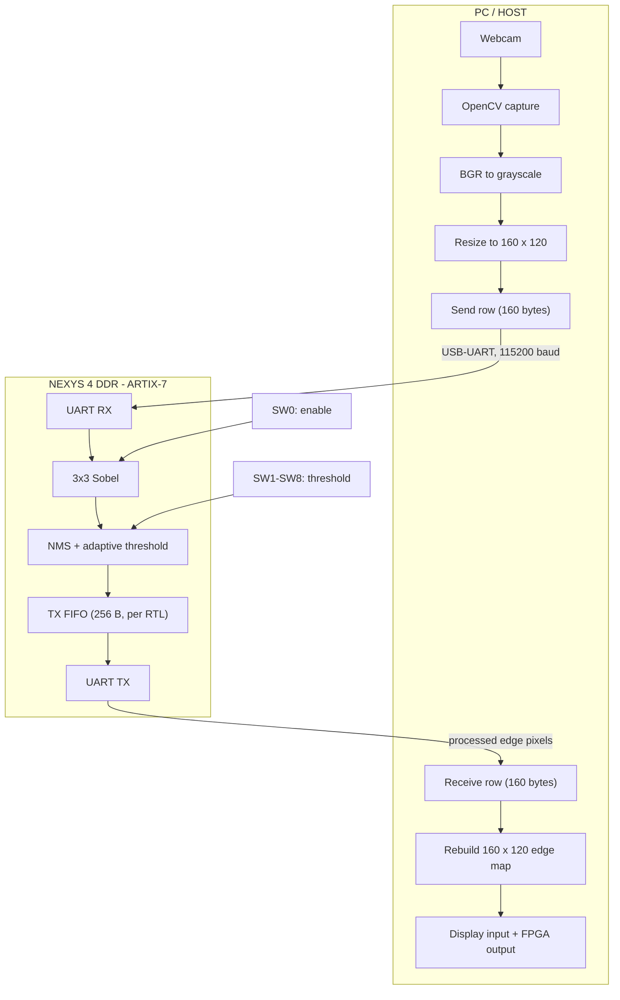

# FPGA-Based Real-Time Sobel Edge Detection Accelerator

**Live webcam → Nexys 4 DDR (Artix-7) → UART → monitor.**
A Verilog Sobel + Non-Maximum Suppression (NMS) + adaptive-threshold pipeline, built in two arithmetic variants (**Exact** and **Logarithmic** multiplier), running on a Digilent Nexys 4 DDR and streamed from a PC webcam over UART.

---

## At a Glance

| | |
|---|---|
| **Board / FPGA** | Digilent Nexys 4 DDR, Xilinx Artix-7 `xc7a100tcsg324-1` |
| **Clock** | 100 MHz (10 ns), pin E3 |
| **Pipeline** | 3 × 3 Sobel → NMS → adaptive threshold → binary edge pixel |
| **Variants** | Exact multiplier / Logarithmic multiplier |
| **Link to PC** | UART, 115200 baud, 8-N-1, onboard USB-UART bridge |
| **Frame** | 160 × 120 grayscale, 19,200 bytes |
| **Live controls** | SW0 = enable, SW1–SW8 = 8-bit threshold |
| **Host software** | Python, OpenCV, NumPy, PySerial |
| **Tools** | Vivado 2025.1 |
| **Status** | End-to-end demo run on hardware; reports below are synthesis-stage |

### Headline results (Vivado 2025.1, 3 Nov 2026)

| Metric | Exact | Logarithmic | Difference (Log − Exact) |
|---|---:|---:|---:|
| Slice LUTs | **756** (1.19 %) | **804** (1.27 %) | +48 (+6.35 %) |
| Slice registers | 472 (0.37 %) | 472 (0.37 %) | 0 |
| BRAM / DSP | 0 / 0 | 0 / 0 | 0 |
| Setup WNS @ 100 MHz | **+4.313 ns** | **+4.079 ns** | −0.234 ns |
| Hold WHS | +0.137 ns | +0.137 ns | 0 |
| Total on-chip power (estimate) | 0.106 W | 0.106 W | 0 |
| DRC checks found | 0 | 0 | 0 |

> **Reading these numbers:** all ten reports have `Design State: Synthesized` and unplaced nets, and the power confidence is **Low**. They show that both variants meet 100 MHz at synthesis stage. They do **not** show an area, timing or power advantage for the Logarithmic multiplier. See [Section 10](#10-implementation-results) and [Section 14](#14-known-limitations).

---

## Contents

1. [Project Overview](#1-project-overview)
2. [System Architecture](#2-system-architecture)
3. [Hardware and Software](#3-hardware-and-software)
4. [Image-Processing Pipeline](#4-image-processing-pipeline)
5. [Exact vs Logarithmic Multiplier](#5-exact-vs-logarithmic-multiplier)
6. [UART Interface, TX FIFO and Protocol](#6-uart-interface-tx-fifo-and-protocol)
7. [Host Application](#7-host-application)
8. [Pin Mapping and Board Controls](#8-pin-mapping-and-board-controls)
9. [Running the Demo](#9-running-the-demo)
10. [Implementation Results](#10-implementation-results)
11. [Verification and Design Flow](#11-verification-and-design-flow)
12. [Visual Results](#12-visual-results)
13. [Repository Structure](#13-repository-structure)
14. [Known Limitations](#14-known-limitations)
15. [Future Work](#15-future-work)
16. [Project Status](#16-project-status)
17. [Author](#17-author)

---

## 1. Project Overview

The accelerator implements Sobel edge detection in synthesizable Verilog and extends it with:

- **Non-Maximum Suppression (NMS)** to thin edges.
- **Adaptive thresholding** to separate significant edges from weak responses and noise.
- **Clock-gating logic** to reduce unnecessary switching activity.
- **Two arithmetic variants**, Exact and Logarithmic multiplier, for an approximate-computing comparison.

The full system has been run on a physical Nexys 4 DDR. The PC only captures, downsamples, transmits, receives and displays frames. **All Sobel, NMS and thresholding computation is done in the FPGA fabric**; the host does not filter the returned data.

### Objectives

- Implement Sobel + NMS + adaptive thresholding in Verilog.
- Compare Exact and Logarithmic multipliers on area, timing and power.
- Integrate the design with the Nexys 4 DDR (UART, reset, switches).
- Stream live webcam frames to the FPGA and display the returned edge map.
- Allow edge sensitivity to be changed live from the board switches.

---

## 2. System Architecture



**Data flow**

1. The PC captures a webcam frame, converts it to grayscale and resizes it to 160 × 120.
2. The frame is sent to the FPGA one 160-byte row at a time.
3. The FPGA receives pixels, runs Sobel → NMS → threshold, and queues output bytes in the TX FIFO.
4. The UART transmitter returns 160 processed bytes per row.
5. Python reassembles the rows and shows the input and the FPGA output side by side.

UART is full duplex: input pixels and output pixels travel on separate wires (C4 and D4).

---

## 3. Hardware and Software

### 3.1 FPGA board

| Parameter | Value |
|---|---|
| Board | Digilent Nexys 4 DDR |
| FPGA | Xilinx Artix-7 XC7A100T, CSG324, speed grade −1 |
| System clock | 100 MHz (10 ns period), pin E3 |

### 3.2 Host computer

| Component | Technology |
|---|---|
| Language | Python |
| Webcam capture | OpenCV (`cv2`) |
| Array handling | NumPy |
| Serial | PySerial, 115200 baud |
| Port used in development | `COM13` (machine-dependent) |

### 3.3 Tools

AMD/Xilinx Vivado 2025.1 (synthesis, timing, DRC, power and utilization reports), Verilog RTL.

---

## 4. Image-Processing Pipeline

```text
Grayscale pixels → 3×3 window → Sobel Gx, Gy → gradient magnitude → NMS → adaptive threshold → edge pixel → TX FIFO → UART TX
```

### 4.1 Sobel operator

Two 3 × 3 kernels estimate horizontal and vertical intensity change:

$$
K_x=\begin{bmatrix}-1&0&+1\\-2&0&+2\\-1&0&+1\end{bmatrix},\qquad
K_y=\begin{bmatrix}-1&-2&-1\\0&0&0\\+1&+2&+1\end{bmatrix}
$$

$$
G_x=\sum_{i,j}K_x(i,j)\,I(i,j),\qquad G_y=\sum_{i,j}K_y(i,j)\,I(i,j)
$$

The gradient components are combined into an edge-strength (magnitude) value. Large values indicate strong boundaries; small values indicate smooth regions.

### 4.2 Non-Maximum Suppression

Raw Sobel output is several pixels wide around a boundary. NMS keeps local maxima along the gradient direction and suppresses the rest, giving thinner, better-localised edges.

```text
Before NMS:   █████        After NMS:   █
              █████                     █
              █████                     █
```

### 4.3 Adaptive thresholding and live control

The thresholding stage converts the NMS output into a binary edge map: `0` for background or suppressed pixels, non-zero (edge value per the RTL output encoding) for retained edges. The threshold comes from the board switches, so it can be tuned live without rebuilding the bitstream.

| Threshold setting | Effect |
|---|---|
| Too low | Noise and weak responses survive; output looks nearly solid white |
| Moderate | Strong boundaries retained, background suppressed |
| Too high | Fine, useful edges disappear |

The best value depends on scene, lighting and contrast. SW0 is the master enable; SW1–SW8 only set sensitivity.

### 4.4 Clock gating

Clock-gating logic reduces switching in idle processing stages. It targets **dynamic** power only; static (leakage) power is unaffected:

$$
P_{total}=P_{static}+P_{dynamic}
$$

The current power reports are low-confidence synthesis estimates and **cannot** be used to quantify the clock-gating benefit (see [Section 10.5](#105-power)).

---

## 5. Exact vs Logarithmic Multiplier

| Variant | Description |
|---|---|
| **Exact** | Conventional multiplication. Reference for arithmetic, edge-map quality, resources, timing and power. |
| **Logarithmic** | Logarithm-based approximate multiplication, intended to test whether approximation can lower hardware cost or power at acceptable image quality. |

Approximation changes intermediate gradient values, which can change which pixels survive NMS and thresholding. Efficiency must therefore be judged on both hardware metrics and image quality.

**Evaluation criteria:** LUT/FF/BRAM/DSP use, setup/hold timing, dynamic and static power, edge-map similarity, and image metrics (MSE, PSNR, SSIM) computed on matched reference images.

**Current finding (synthesis stage):** the Logarithmic build uses 48 more LUTs, has 0.234 ns less setup slack, and shows identical estimated power. No hardware advantage has been demonstrated yet. Full data in [Section 10](#10-implementation-results).

---

## 6. UART Interface, TX FIFO and Protocol

### 6.1 UART configuration

| Parameter | Value |
|---|---|
| Baud rate | 115200, 8-N-1 |
| FPGA clock | 100 MHz |
| `CLKS_PER_BIT` | 868 |
| Modules | `uart_rx`, `uart_tx` |
| FPGA RX pin | C4 (`uart_rxd`) |
| FPGA TX pin | D4 (`uart_txd`) |

$$
\text{CLKS\_PER\_BIT}=\frac{f_{clk}}{f_{baud}}=\frac{100{,}000{,}000}{115{,}200}\approx 868
$$

One bit lasts ≈ 8.68 µs; one byte (start + 8 data + stop = 10 bit periods) lasts ≈ 86.8 µs.

### 6.2 Reset polarity

The CPU reset pushbutton (C12) is **active-low**; the internal logic expects an active-high reset:

```verilog
internal_rst = ~rst;
```

Keep reset polarity consistent across the top level and all UART and processing modules.

### 6.3 Transmit FIFO

The FPGA can produce output bytes far faster than UART can send them (one byte per ≈ 86.8 µs). `Sobel_Top.v` therefore includes a 256-byte transmit FIFO:

```verilog
tx_fifo [0:255]      // storage
tx_fifo_wr_ptr       // write pointer
tx_fifo_rd_ptr       // read pointer
```

```text
Edge pixel → FIFO write → 256-byte FIFO → FIFO read (when tx_busy = 0) → UART TX → PC
```

While `tx_busy` is high, new pixels wait in the FIFO and the next byte is handed to the transmitter when it frees up. Lossless operation additionally depends on correct full/empty detection, pointer wraparound and write blocking when full.

> **Note:** the depth and signal names above describe the RTL. The utilization reports do not confirm how (or whether) this FIFO was mapped; see [Section 14.2](#142-fifo-and-line-storage-mapping).

### 6.4 Row-by-row protocol

```text
For each of the 120 rows:
    host  → FPGA : send 160 pixel bytes
    FPGA  → host : return 160 processed bytes
host rebuilds the 160 × 120 output frame
```

| Item | Bytes |
|---|---:|
| Input row | 160 |
| Output row | 160 |
| Rows per frame | 120 |
| Input frame | 19,200 |
| Output frame | 19,200 |

The host waits for each returned row before sending the next, which bounds outstanding data and gives a simple sync point. There is **no** packet header, checksum, sequence number or frame delimiter; row length and transaction order are the only synchronisation. A dropped or extra byte will therefore misalign the image.

### 6.5 Bandwidth and frame rate

$$
\text{payload rate}=\frac{115{,}200}{10}=11{,}520\ \text{bytes/s}
\qquad
T_{one\text{-}way}=\frac{19{,}200}{11{,}520}\approx1.67\ \text{s}
$$

With strictly sequential request/response the serial lower bound is ≈ 1.67 + 1.67 = **3.33 s per frame (≈ 0.30 fps)**, before Python and driver overhead. **The 115200-baud link, not the FPGA, limits the frame rate.** Because UART is full duplex, overlapping send and receive could in principle approach ≈ 1.67 s per frame (≈ 0.60 fps) at the same baud rate.

---

## 7. Host Application

Implemented in `host_stream.py` using OpenCV, NumPy and PySerial.

| Step | Code / behaviour |
|---|---|
| Open webcam | `cap = cv2.VideoCapture(0)` |
| Grayscale | `cv2.cvtColor(frame, cv2.COLOR_BGR2GRAY)` |
| Resize | `WIDTH = 160`, `HEIGHT = 120` → 19,200 pixels, 1 byte each |
| Send | `ser.write(row.tobytes())` for each of 120 rows |
| Receive | `ser.read(WIDTH)` after each row |
| Rebuild | `np.vstack` of returned rows into a 160 × 120 `uint8` image |
| Display | Windows `Webcam Input` and `FPGA Sobel Output` |
| Save | First frame pair as `first_webcam_input.png` and `first_fpga_sobel_output.png` |

Illustrative transaction loop (the real code is in `host_stream.py`):

```python
for row in frame:
    ser.write(row.tobytes())
    processed_row = ser.read(WIDTH)
    output_rows.append(np.frombuffer(processed_row, dtype=np.uint8))

output_frame = np.vstack(output_rows)
```

The output window shows bytes returned by the FPGA, not a software Sobel result.

---

## 8. Pin Mapping and Board Controls

| Board interface | FPGA pin / signal | Purpose |
|---|---|---|
| 100 MHz clock | E3 (`clk`) | System clock (from timing reports) |
| UART receive | C4 (`uart_rxd`) | PC → FPGA |
| UART transmit | D4 (`uart_txd`) | FPGA → PC |
| CPU reset button | C12 | Active-low reset |
| SW0 | J15 | Master accelerator enable |
| SW1–SW8 | `threshold[7:0]` | Live threshold |

Report cross-check: the utilization reports show 14 bonded IOBs (12 IBUF + 2 OBUF), and the timing reports list 11 inputs and 2 outputs besides `clk`. The 11 inputs match `uart_rxd`, reset, SW0 and the eight threshold switches. Only `uart_txd` is documented as an output here; identify the second output from the XDC file. Always check the full constraints in the project XDC before programming.

---

## 9. Running the Demo

### 9.1 Requirements

```bash
pip install opencv-python numpy pyserial
```

A webcam, a Nexys 4 DDR connected by USB, the `Sobel_Top` bitstream (Exact or Logarithmic build), and the correct COM port.

### 9.2 Program the FPGA

1. Open the Vivado project and set `Sobel_Top` as top.
2. Verify the pin constraints (UART, reset, switches).
3. Run synthesis and implementation, then generate the bitstream.
4. Open Hardware Manager, connect to the board and program it.

### 9.3 Configure and run the host

```python
PORT = "COM13"      # change to your port
BAUD_RATE = 115200
WIDTH = 160
HEIGHT = 120
```

Close any other program using the port, then run:

```bash
python host_stream.py
```

### 9.4 Tune the output

Set SW0 on, then adjust SW1–SW8 while watching `FPGA Sobel Output`. If the image is mostly white, raise the threshold; if useful edges vanish, lower it.

---

## 10. Implementation Results

### 10.1 Report sets and provenance

All figures come from Vivado 2025.1 (win64, build 6140274) reports generated on 3 Nov 2026 for design `Sobel_Top`, device `xc7a100tcsg324-1`. There are two sets of five reports:

| Set | Multiplier | Report folder (from report commands) | Generated (local time) |
|---|---|---|---|
| First five reports | **Logarithmic** | `reports/log/` | 18:07 – 18:09 |
| Next five reports | **Exact** | `reports/exact/` | 17:51 – 17:55 |

| Report | Exact file | Logarithmic file |
|---|---|---|
| DRC | `exact/DRC_drc_1.txt` | `log/DRC_drc_1.txt` |
| Utilization | `exact/utilization_report.txt` | `log/utilization_report.txt` |
| Power | `exact/power_report.txt` | `log/power.txt` |
| Timing summary | `exact/timing_summary.txt` | `log/timing_summary.txt` |
| Timing summary (named “routed”) | `exact/timing_summary_routed.txt` | `log/timing_summary_routed.txt` |

> **Stage warning.** Every report header says `Design State: Synthesized`, and the timing paths show `unplaced` nets (no placement or routing delays). The two files named `timing_summary_routed.txt` are identical to their `timing_summary.txt` counterparts apart from the timestamp and command line, so they are **not** post-route results. The hardware demonstration is a separate, completed validation and does not change the stage of these reports.

### 10.2 DRC

| | Exact | Logarithmic |
|---|---|---|
| Ruledeck | default | default |
| Design state | Synthesized | Synthesized |
| Checks found | **0** | **0** |

No rules were violated in either synthesis-stage DRC.

### 10.3 Utilization (`report_utilization`)

**Slice logic**

| Resource | Exact | Logarithmic | Available | Exact % | Log % |
|---|---:|---:|---:|---:|---:|
| Slice LUTs | 756 | 804 | 63,400 | 1.19 | 1.27 |
| – LUT as logic | 756 | 804 | 63,400 | 1.19 | 1.27 |
| – LUT as memory | 0 | 0 | 19,000 | 0.00 | 0.00 |
| Slice registers | 472 | 472 | 126,800 | 0.37 | 0.37 |
| – as flip-flop | 472 | 472 | 126,800 | 0.37 | 0.37 |
| – as latch | 0 | 0 | 126,800 | 0.00 | 0.00 |
| F7 muxes | 37 | 37 | 31,700 | 0.12 | 0.12 |
| F8 muxes | 18 | 18 | 15,850 | 0.11 | 0.11 |
| CARRY4 | 40 | 40 | 15,850 | 0.25 | 0.25 |

**Memory, DSP, I/O, clocking**

| Resource | Exact | Logarithmic | Available | Util % |
|---|---:|---:|---:|---:|
| Block RAM tiles (RAMB36 / RAMB18) | 0 / 0 | 0 / 0 | 135 / 270 | 0.00 |
| DSP48 | 0 | 0 | 240 | 0.00 |
| Bonded IOB | 14 | 14 | 210 | 6.67 |
| BUFGCTRL | 1 | 1 | 32 | 3.13 |
| MMCM / PLL | 0 | 0 | 6 / 6 | 0.00 |

**Registers by control type** (identical in both): 206 with clock-enable + async reset (`FDCE`), 265 with clock-enable + sync reset (`FDRE`), 1 with clock-enable + async set (`FDPE`).

**Primitive breakdown**

| Primitive | Exact | Logarithmic | Δ (Log − Exact) |
|---|---:|---:|---:|
| LUT6 | 455 | 493 | +38 |
| LUT3 | 298 | 312 | +14 |
| LUT4 | 91 | 105 | +14 |
| LUT5 | 75 | 73 | −2 |
| LUT2 | 18 | 20 | +2 |
| LUT1 | 4 | 4 | 0 |
| FDRE | 265 | 265 | 0 |
| FDCE | 206 | 206 | 0 |
| FDPE | 1 | 1 | 0 |
| CARRY4 | 40 | 40 | 0 |
| MUXF7 / MUXF8 | 37 / 18 | 37 / 18 | 0 |
| IBUF / OBUF | 12 / 2 | 12 / 2 | 0 |
| BUFG | 1 | 1 | 0 |

The raw LUT primitives sum to more than the reported Slice LUT count because Vivado reports an adjusted figure that accounts for LUT combining. Final LUT counts after `opt_design` and full implementation are typically lower.

**Takeaway:** the Logarithmic build uses 48 more LUTs ($\frac{804-756}{756}\approx 6.35\,\%$). Everything else is identical. No area saving is shown.

### 10.4 Timing (`report_timing_summary`)

Constraint: `clk`, period 10 ns (waveform 0 – 5 ns), 100 MHz. Analysis covers slow and fast corners. Both builds report *“All user specified timing constraints are met.”*

| Metric | Exact | Logarithmic |
|---|---:|---:|
| Setup WNS | **+4.313 ns** | **+4.079 ns** |
| Setup TNS | 0.000 ns | 0.000 ns |
| Setup failing / total endpoints | 0 / 588 | 0 / 588 |
| Hold WHS | +0.137 ns | +0.137 ns |
| Hold THS | 0.000 ns | 0.000 ns |
| Hold failing / total endpoints | 0 / 588 | 0 / 588 |
| Pulse-width WPWS | +4.500 ns | +4.500 ns |
| Pulse-width failing / total endpoints | 0 / 473 | 0 / 473 |
| Min-period check (BUFG) | 2.155 ns required, 10.000 ns actual | same |
| Indicative min period (10 ns − WNS) | ≈ 5.69 ns (≈ 176 MHz) | ≈ 5.92 ns (≈ 169 MHz) |

The last row is a rough synthesis-stage headroom estimate, not an achievable-Fmax claim, because wire delays are not yet placed.

**Worst setup path**

| | Exact | Logarithmic |
|---|---|---|
| Slack | +4.313 ns | +4.079 ns |
| Source | `row0_0_reg[0]` | `row0_2_reg[0]` |
| Destination | `uut/gx_reg[9]` | `uut/gy_reg[9]` |
| Data-path delay | 5.583 ns | 5.817 ns |
| – logic / route | 2.940 ns (52.7 %) / 2.643 ns (47.3 %) | 2.886 ns (49.6 %) / 2.931 ns (50.4 %) |
| Logic levels | 9 (CARRY4 ×4, LUT3 ×2, LUT4, LUT5, LUT6) | 8 (CARRY4 ×3, LUT3 ×2, LUT4, LUT6 ×2) |
| Clock uncertainty | 0.035 ns | 0.035 ns |

In both builds the critical path is the Sobel gradient accumulation (`gx` / `gy` registers inside `uut`), not the UART.

**Worst hold path (both builds):** `u_uart_tx/tx_data_reg[0]` back to itself through one LUT6, slack +0.137 ns (data-path delay 0.381 ns, fast corner). Hold slack at synthesis stage is optimistic until clock skew and routing are known.

**`check_timing` results (identical in both)**

| Check | Count |
|---|---:|
| Registers with no clock / constant clock / multiple clocks | 0 |
| Unconstrained internal endpoints | 0 |
| Combinational loops / latch loops | 0 |
| Generated clocks not connected to a source | 0 |
| Input ports with no input delay but covered by a false path | 11 (MEDIUM) |
| Output ports with no output delay but covered by a false path | 2 (MEDIUM) |

The false-path exceptions on the board I/O should be reviewed to confirm they suit the final interface. `report_methodology` has not been run.

### 10.5 Power

`report_power`, synthesized design, commercial grade, typical process, production device models.

**Summary**

| Metric | Exact | Logarithmic |
|---|---:|---:|
| Total on-chip power | 0.106 W | 0.106 W |
| Dynamic power | 0.009 W | 0.009 W |
| Device static power | 0.097 W | 0.097 W |
| Effective θJA | 4.6 °C/W | 4.6 °C/W |
| Junction temperature | 25.5 °C | 25.5 °C |
| Max ambient | 84.5 °C | 84.5 °C |
| Design power budget | Unspecified | Unspecified |
| **Confidence level** | **Low** | **Low** |

**By on-chip component** (power in W)

| Component | Exact | Logarithmic |
|---|---:|---:|
| Clocks | 0.006 (3 used) | 0.006 (3 used) |
| Slice logic | < 0.001 (1,520 used) | < 0.001 (1,586 used) |
| – LUT as logic | < 0.001 (756) | < 0.001 (804) |
| – CARRY4 | < 0.001 (40) | < 0.001 (40) |
| – Register | < 0.001 (472) | < 0.001 (472) |
| – F7/F8 muxes | < 0.001 (55) | < 0.001 (55) |
| Signals | < 0.001 (1,095) | < 0.001 (1,159) |
| I/O | 0.002 (14 of 210) | 0.002 (14 of 210) |
| Static | 0.097 | 0.097 |
| **Total** | **0.106** | **0.106** |

By hierarchy (both): `Sobel_Top` 0.009 W, of which `u_uart_rx` 0.001 W.

<details>
<summary>Supply-rail currents (identical in both builds)</summary>

| Rail | Voltage (V) | Total (A) | Dynamic (A) | Static (A) |
|---|---:|---:|---:|---:|
| Vccint | 1.000 | 0.023 | 0.008 | 0.015 |
| Vccaux | 1.800 | 0.018 | 0.000 | 0.018 |
| Vcco33 | 3.300 | 0.004 | 0.000 | 0.004 |
| Vccadc | 1.800 | 0.020 | 0.000 | 0.020 |
| Vcco25 / Vcco18 / Vcco15 / Vcco135 / Vcco12 | 2.5 / 1.8 / 1.5 / 1.35 / 1.2 | 0.000 | 0.000 | 0.000 |
| Vccaux_io, Vccbram, MGTAVcc, MGTAVtt | 1.8 / 1.0 / 1.0 / 1.2 | 0.000 | 0.000 | 0.000 |

Environment: ambient 25 °C, airflow 250 LFM, medium heat sink, θSA 4.6 °C/W, 10″ × 10″ board with 12–15 layers.

</details>

**Confidence breakdown** (identical in both)

| Input data | Confidence | Reason |
|---|---|---|
| Design implementation state | Low | Design is only synthesized |
| Clock-node activity | High | > 95 % of clocks specified |
| I/O-node activity | Low | > 75 % of inputs have no activity specified |
| Internal-node activity | Medium | < 25 % of internal nodes specified |
| Device models | High | Production |
| **Overall** | **Low** | No simulation activity file |

Static power is 92 % of the total (97 of 106 mW). Both estimates are preliminary and are neither measured board power nor evidence for or against clock gating or the multiplier choice.

### 10.6 Side-by-side verdict

| Question | Answer from the supplied reports |
|---|---|
| Do both build and pass DRC? | Yes, 0 checks found |
| Do both meet 100 MHz? | Yes, at synthesis stage |
| Which has more timing slack? | Exact, by 0.234 ns |
| Which uses fewer LUTs? | Exact, by 48 LUTs (6.35 %) |
| Which uses less power? | Not distinguishable (0.106 W each, low confidence) |
| Is a Logarithmic advantage shown? | **No** |

To make the comparison conclusive, rerun both builds through placement and routing, supply simulation activity (SAIF/VCD) to `report_power`, and compare output image quality on matched frames.

---

## 11. Verification and Design Flow

```text
Verilog RTL → RTL simulation → Synthesis → Optimization → Placement → Routing
→ Timing / DRC → Power and utilization reports → Bitstream → Nexys 4 DDR → Webcam demo
```

**RTL testbenches:** `tb_SobelFilter` (Sobel logic) and `tb_SobelImage` (image-level behaviour). Waveform screenshots go in `assets/waveforms/`.

**Hardware validation:** the full path (webcam, UART in, FPGA processing, FIFO, UART out, host reconstruction and display) has been run on the physical Nexys 4 DDR. This is separate from, and in addition to, the testbench and Vivado report results.

**Not yet established:** post-route timing, power with real switching activity, and a quantitative Exact-vs-Log image-quality comparison.

---

## 12. Visual Results

Keep the files at these paths if they are in the repository.

| Figure | Image | Description |
|---|---|---|
| 1 |  | Original input |
| 2 |  | Baseline Sobel: thicker, denser edges |
| 3 |  | Sobel + NMS + adaptive threshold, **Exact** multiplier |
| 4 |  | Sobel + NMS + adaptive threshold, **Logarithmic** multiplier |

Compare Figures 3 and 4 using the same input frame, threshold and dimensions.

**Live demo output:** the first captured pair is saved as `first_webcam_input.png` and `first_fpga_sobel_output.png` and can be added to `assets/` as evidence.

---

## 13. Repository Structure

Suggested layout; keep your actual Vivado project structure where required.

```text
Sobel-edge-detection-accelerator/
├── Sobel_Log_Accelerator.srcs/
├── rtl/                 SobelFilter.v, Sobel_Top.v, uart_rx.v, uart_tx.v, ...
├── simulation/          tb_SobelFilter.v, tb_SobelImage.v
├── constraints/         XDC files
├── host/                host_stream.py   (or keep in repo root)
├── assets/
│   ├── original_input.jpg
│   ├── sobel_without_nms.jpg
│   ├── sobel_nms_adaptive_exact.bmp
│   ├── sobel_nms_adaptive_log.bmp
│   ├── first_webcam_input.png
│   ├── first_fpga_sobel_output.png
│   └── waveforms/       tb_SobelFilter.png, tb_SobelImage.png
├── reports/
│   ├── exact/           DRC_drc_1.txt, power_report.txt, timing_summary.txt,
│   │                    timing_summary_routed.txt, utilization_report.txt
│   └── log/             DRC_drc_1.txt, power.txt, timing_summary.txt,
│                        timing_summary_routed.txt, utilization_report.txt
├── bitstream/           Sobel_Top.bit
└── README.md
```

---

## 14. Known Limitations

### 14.1 Report stage
All ten reports are synthesis-stage (`Design State: Synthesized`, unplaced nets). WNS/WHS are therefore pre-placement estimates, and the `*_routed.txt` files contain no post-route data.

### 14.2 FIFO and line-storage mapping
The RTL describes a 256 × 8-bit FIFO (2,048 bits). The reports show **0 BRAM, 0 LUT-as-memory and 472 flip-flops in total** for the whole design (a 3 × 3 window alone is 72 flops, plus UART and control). That leaves no visible room for the 2,048-bit FIFO, or for any line buffers (one 160-pixel line is 1,280 bits).

Check in Vivado and the RTL which of these applies: the reports predate the FIFO, the FIFO was trimmed or reduced, or the neighbouring rows are supplied by the host rather than stored on the FPGA. Document how the 3 × 3 neighbourhood is formed from the row-by-row stream, and do not assume BRAM use from the array declaration alone.

### 14.3 FIFO robustness
Correct behaviour needs full/empty handling, pointer wraparound, simultaneous read/write and reset initialisation. The row-by-row protocol limits outstanding data but does not remove the need for these checks.

### 14.4 Image borders
Document the border policy (zero padding, suppressed borders, etc.) from the final RTL rather than assuming one.

### 14.5 Protocol robustness
No header, checksum, sequence number or frame delimiter. A lost byte misaligns the image until the stream is resynchronised.

### 14.6 UART throughput
≈ 3.33 s per frame minimum with the current sequential protocol at 115200 baud ([Section 6.5](#65-bandwidth-and-frame-rate)).

### 14.7 Power confidence
Both power reports are Low confidence with no activity file. 106 mW is not measured power.

### 14.8 Host environment
`COM13` and the Windows project path are specific to the development machine.

---

## 15. Future Work

**Throughput and communication**
- Overlap send and receive (pipelined streaming) instead of strict row-by-row.
- Raise the baud rate after checking clock-divider error and signal integrity, or move to a faster USB interface.
- Add frame/row markers, checksums or sequence counters, and FIFO overflow reporting.

**FPGA architecture**
- Confirm FIFO and line-buffer mapping; consider BRAM-based buffering.
- Optimise the 3 × 3 window generation and pipeline throughput.
- Obtain post-route timing and activity-annotated power for both variants.

**Image quality**
- Compare Exact and Logarithmic outputs on matched frames with MSE, PSNR, SSIM and edge precision/recall.
- Quantify NMS and thresholding contributions separately and test threshold sensitivity across lighting.
- Evaluate larger resolutions.

**Hardware validation**
- Long-duration and reset-recovery tests, FIFO stress tests, end-to-end latency and measured frame rate, and comparison against a software reference.

---

## 16. Project Status

| Component | Status |
|---|---|
| Sobel RTL, NMS, adaptive threshold | Implemented |
| Exact and Logarithmic multipliers | Implemented |
| Clock-gating logic | Implemented |
| Nexys 4 DDR top level, UART RX/TX | Implemented |
| 256-byte TX FIFO | In RTL description; mapping not confirmed by reports |
| Python capture, resize, row transfer, reconstruction, display | Implemented |
| Switch-based threshold control | Mapped in documented interface |
| Physical end-to-end demo on Nexys 4 DDR | Demonstrated |
| Synthesis-stage DRC | 0 checks (both variants) |
| 100 MHz timing | Met at synthesis stage (both variants) |
| Post-route timing | Not yet established |
| Measured / activity-based power | Not yet established |
| Logarithmic-multiplier advantage | Not demonstrated by current reports |

---

## 17. Author

**Kushagra Kartikeye**
FPGA Design | Digital Systems | Embedded Processing | Image Processing

---

*The FPGA performs the image processing; the PC handles webcam capture, UART communication, frame reconstruction and display. Resource, timing, DRC and power figures are taken from the Vivado 2025.1 reports dated 3 November 2026, with report stage and power confidence stated as they appear in those reports.*
