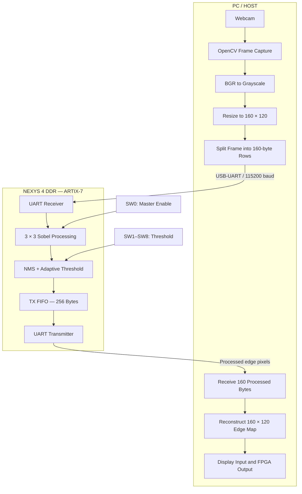

# FPGA-Based Real-Time Sobel Edge Detection Accelerator

```{=html}
<p align="center">
```
```{=html}
<h2 align="center">
```
Real-Time Webcam-to-FPGA Sobel Edge Detection
```{=html}
</h2>
```
```{=html}
<p align="center">
```
Artix-7 FPGA acceleration with Non-Maximum Suppression, adaptive
thresholding, Exact and Logarithmic multiplier variants, UART streaming,
hardware buffering, and live threshold control.
```{=html}
</p>
```
```{=html}
</p>
```

------------------------------------------------------------------------

## Table of Contents

1.  [Project Overview](#1-project-overview)
2.  [Key Features](#2-key-features)
3.  [System Hardware and Software](#3-system-hardware-and-software)
4.  [System Architecture](#4-system-architecture)
5.  [Image Processing Pipeline](#5-image-processing-pipeline)
6.  [Sobel Edge Detection](#6-sobel-edge-detection)
7.  [Non-Maximum Suppression](#7-non-maximum-suppression)
8.  [Adaptive Thresholding and FPGA
    Controls](#8-adaptive-thresholding-and-fpga-controls)
9.  [Exact and Logarithmic Multiplier
    Variants](#9-exact-and-logarithmic-multiplier-variants)
10. [Clock Gating and Power
    Considerations](#10-clock-gating-and-power-considerations)
11. [UART Communication Interface](#11-uart-communication-interface)
12. [Hardware TX FIFO and Data Flow
    Control](#12-hardware-tx-fifo-and-data-flow-control)
13. [Python Webcam Host Application](#13-python-webcam-host-application)
14. [Host-FPGA Transaction Protocol](#14-host-fpga-transaction-protocol)
15. [FPGA Pin Mapping and Board
    Controls](#15-fpga-pin-mapping-and-board-controls)
16. [Running the Live Demonstration](#16-running-the-live-demonstration)
17. [Vivado Implementation and
    Verification](#17-vivado-implementation-and-verification)
18. [Implementation Results](#18-implementation-results)
19. [Visual Results and Demonstration
    Assets](#19-visual-results-and-demonstration-assets)
20. [Repository Structure](#20-repository-structure)
21. [Known Limitations and Verification
    Notes](#21-known-limitations-and-verification-notes)
22. [Future Work](#22-future-work)
23. [Author](#23-author)

------------------------------------------------------------------------

# 1. Project Overview

This project implements a hardware-accelerated Sobel edge-detection
pipeline on the **Digilent Nexys 4 DDR development board**, which is
built around a **Xilinx Artix-7 XC7A100T FPGA**.

The original image-processing accelerator implements the Sobel operator
and extends it with:

-   **Non-Maximum Suppression (NMS)** to thin and localize detected
    edges.
-   **Adaptive thresholding** to distinguish significant edge responses
    from weaker responses and background noise.
-   **Clock-gating logic** to reduce unnecessary switching activity.
-   Two arithmetic configurations: an **Exact multiplier** and a
    **Logarithmic multiplier**, enabling an approximate-computing
    comparison.

The system has now been extended beyond offline RTL/image processing. A
PC webcam can supply live image frames to the FPGA over a USB-UART
connection. The FPGA processes the incoming grayscale pixels and returns
the resulting edge pixels to the host, where Python reconstructs and
displays the output frame.

The resulting system combines three major parts:

1.  **FPGA image-processing hardware:** the Sobel, NMS, thresholding,
    control, UART, and buffering logic.
2.  **Serial communication and flow control:** UART receive/transmit
    modules and a hardware transmit FIFO.
3.  **PC-side image acquisition and visualization:** an OpenCV/PySerial
    application that captures, downsamples, transmits, receives,
    reconstructs, and displays frames.

The project therefore evaluates both the image-processing architecture
and the practical integration challenges involved in streaming image
data to a resource-constrained FPGA over a comparatively low-bandwidth
serial link.

## Project objectives

-   Implement a Sobel-based edge detector in synthesizable Verilog.
-   Refine the edge map using NMS and adaptive thresholding.
-   Compare Exact and Logarithmic multiplier implementations.
-   Integrate the accelerator with the Nexys 4 DDR board.
-   Transfer image pixels between a PC and FPGA using UART at 115200
    baud.
-   Capture webcam frames and preprocess them on the host.
-   Reconstruct and display FPGA-generated edge maps.
-   Provide user-controlled edge sensitivity through physical FPGA
    switches.
-   Evaluate FPGA timing, logic utilization, and estimated power.

------------------------------------------------------------------------

# 2. Key Features

  -----------------------------------------------------------------------
  Feature                             Description
  ----------------------------------- -----------------------------------
  FPGA platform                       Digilent Nexys 4 DDR, Artix-7
                                      XC7A100T

  Processing clock                    100 MHz

  Edge detector                       3 × 3 Sobel operator

  Edge refinement                     Non-Maximum Suppression

  Edge selection                      Adaptive thresholding

  Arithmetic variants                 Exact and Logarithmic multiplier

  Power optimization                  Clock-gating logic

  Host communication                  UART over onboard USB-UART bridge

  UART baud rate                      115200 baud

  UART clock divider                  `CLKS_PER_BIT = 868`

  Host application                    Python, OpenCV, NumPy, PySerial

  Webcam input                        `cv2.VideoCapture(0)`

  Processing resolution               160 × 120 grayscale pixels

  Frame payload                       19,200 bytes

  Hardware buffering                  256-byte transmit FIFO, as
                                      described by the RTL design

  Threshold control                   FPGA switches SW1--SW8

  Master enable                       FPGA switch SW0
  -----------------------------------------------------------------------

------------------------------------------------------------------------

# 3. System Hardware and Software

## 3.1 FPGA development board

**Digilent Nexys 4 DDR**

  Parameter      Specification
  -------------- ----------------
  FPGA family    Xilinx Artix-7
  FPGA device    XC7A100T
  Package        CSG324
  Speed grade    -1
  System clock   100 MHz
  Clock period   10 ns

The FPGA is responsible for receiving pixel data, processing the image
through the hardware edge-detection pipeline, and transmitting the
processed pixel values back to the PC.

## 3.2 Host computer

The host computer performs image acquisition and serial transaction
management.

  Component                             Technology
  ------------------------------------- ------------------------
  Programming language                  Python
  Webcam capture                        OpenCV (`cv2`)
  Array and frame operations            NumPy
  Serial communication                  PySerial
  FPGA connection                       USB-UART / FTDI bridge
  Serial port used during development   COM13
  Baud rate                             115200

The COM port is machine-dependent. `COM13` is the port used during the
documented development setup; it may need to be changed on another
computer.

## 3.3 FPGA development tools

-   AMD/Xilinx Vivado 2025.1
-   Verilog RTL
-   Vivado synthesis and timing analysis
-   Vivado Design Rule Check (DRC)
-   Vivado power estimation and utilization reporting

------------------------------------------------------------------------

# 4. System Architecture

The complete design consists of a PC-side image pipeline and an
FPGA-side processing pipeline.



The data path is designed around the following sequence:

1.  The PC captures a webcam frame.
2.  OpenCV converts the frame to grayscale and resizes it.
3.  Python divides the frame into rows.
4.  The host sends each row to the FPGA through UART.
5.  The FPGA receives the pixel stream and processes the pixels using
    its image-processing hardware.
6.  The processed edge pixels are placed in the transmit FIFO.
7.  The UART transmitter sends the output bytes to the host.
8.  Python reconstructs the output frame and displays it.

The UART connection is bidirectional: the host transmits source pixels
to the FPGA, while the FPGA transmits processed edge pixels back to the
host.

------------------------------------------------------------------------

# 5. Image Processing Pipeline

The image-processing portion retains the original Sobel/NMS/thresholding
architecture.

``` text
Incoming Grayscale Pixels
          |
          v
   3 × 3 Pixel Window
          |
          v
   Sobel Gradient (Gx, Gy)
          |
          v
    Gradient Magnitude
          |
          v
 Non-Maximum Suppression
          |
          v
 Adaptive Thresholding
          |
          v
    Binary Edge Pixel
          |
          v
       TX FIFO
          |
          v
      UART TX
```

The 3 × 3 neighborhood is required because each output pixel is
evaluated using its surrounding intensity values. The FPGA must
therefore maintain the necessary neighborhood context while the input
stream advances.

The processing pipeline is intended to produce a binary edge
representation:

-   `0`: background or suppressed response.
-   Non-zero / maximum value: retained edge response, according to the
    output encoding used by the RTL.

The host reconstructs the returned pixel bytes into a 160 × 120 image.

------------------------------------------------------------------------

# 6. Sobel Edge Detection

The Sobel operator estimates horizontal and vertical intensity changes
using two 3 × 3 convolution kernels.

## Horizontal gradient

\[ G_x =
```{=tex}
\begin{bmatrix}
-1 & 0 & +1\\
-2 & 0 & +2\\
-1 & 0 & +1
\end{bmatrix}
```
\]

## Vertical gradient

\[ G_y =
```{=tex}
\begin{bmatrix}
-1 & -2 & -1\\
0 & 0 & 0\\
+1 & +2 & +1
\end{bmatrix}
```
\]

For an input neighborhood (I(i,j)):

\[ G_x = `\sum `{=tex}K_x(i,j)I(i,j) \]

\[ G_y = `\sum `{=tex}K_y(i,j)I(i,j) \]

The gradient responses describe the local intensity change in the
horizontal and vertical directions.

A gradient-magnitude calculation combines these components to estimate
edge strength. The exact or approximate arithmetic configuration used by
the design determines the multiplier implementation being evaluated.

Large gradient responses generally indicate strong image boundaries,
while small responses are more likely to correspond to smooth regions or
weak transitions.

------------------------------------------------------------------------

# 7. Non-Maximum Suppression

The raw Sobel response can produce multiple neighboring pixels around a
single image boundary. This results in thick or redundant edge regions.

**Non-Maximum Suppression (NMS)** reduces this redundancy by retaining
local maxima along the estimated gradient direction and suppressing
neighboring responses that are not maximal.

Conceptually:

``` text
Before NMS:             After NMS:

   █████                    █
   █████                    █
   █████                    █
```

NMS improves edge localization and produces a thinner representation of
the detected boundaries.

Its output is passed to the thresholding stage.

------------------------------------------------------------------------

# 8. Adaptive Thresholding and FPGA Controls

The thresholding stage converts the refined gradient response into a
binary edge representation.

A threshold that is too low can classify weak background responses as
edges, producing an excessively bright or nearly solid-white output. A
higher threshold suppresses weaker responses and retains more
significant boundaries.

The FPGA implementation exposes threshold adjustment through the
physical switches on the Nexys 4 DDR.

## Switch mapping

  FPGA control       Function
  ------------------ ---------------------------------------------
  SW0 (`J15`)        Master enable
  SW1--SW8           8-bit threshold input
  `threshold[7:0]`   Threshold value supplied to the accelerator

The eight threshold switches are mapped to the accelerator's
`threshold[7:0]` input.

This allows the edge sensitivity to be adjusted while the system is
operating, without changing the Python source or rebuilding the FPGA
bitstream.

### Practical adjustment

-   A threshold that is too low may retain noise and weak background
    responses.
-   Increasing the threshold suppresses more weak responses.
-   Excessively high values may remove useful fine edges.
-   The most useful setting depends on the input scene, lighting, and
    image contrast.

**SW0** is the master enable control for accelerator execution. The
threshold switches control sensitivity; they do not replace the master
enable.

------------------------------------------------------------------------

# 9. Exact and Logarithmic Multiplier Variants

The project retains two arithmetic configurations for evaluating the
trade-off between exact computation and approximate multiplication.

## 9.1 Exact multiplier

The Exact multiplier performs the required multiplication without
deliberately introducing approximation.

It acts as the reference implementation for:

-   Arithmetic behavior
-   Edge-map comparison
-   FPGA resource utilization
-   Timing analysis
-   Power estimation

## 9.2 Logarithmic multiplier

The Logarithmic multiplier uses a logarithmic/approximate arithmetic
approach as an alternative to conventional exact multiplication.

The purpose is to evaluate whether approximate arithmetic can reduce
hardware cost or power while maintaining acceptable edge-map quality.

Approximation can introduce numerical differences in intermediate
gradient calculations. Those differences may affect which pixels survive
NMS and thresholding.

It is therefore necessary to compare both the numerical and image-level
behavior rather than assuming that the approximate implementation is
automatically more efficient.

## 9.3 Evaluation criteria

The two configurations should be evaluated using:

-   LUT utilization
-   Register utilization
-   BRAM and DSP utilization
-   Setup and hold timing
-   Estimated dynamic and static power
-   Edge-map similarity
-   Image-quality metrics such as MSE, PSNR, and SSIM, when calculated
    using correctly matched reference images

The latest supplied Vivado reports are documented in [Implementation
Results](#18-implementation-results).

------------------------------------------------------------------------

# 10. Clock Gating and Power Considerations

Clock switching contributes to dynamic power in synchronous digital
systems.

The accelerator includes clock-gating logic intended to reduce
unnecessary switching activity when processing stages do not need to
perform useful work.

Conceptually:

``` text
             Enable
               |
               v
System Clock --> Clock-Gating Logic
                       |
                       v
                  Gated Clock
                       |
                       v
                Processing Logic
```

The intended benefit is a reduction in switching activity in the gated
portion of the design.

Total power can be expressed as:

\[ P\_{`\text{total}`{=tex}} = P\_{`\text{static}`{=tex}} +
P\_{`\text{dynamic}`{=tex}} \]

Clock gating primarily targets dynamic power. It does not eliminate the
FPGA's static or leakage power.

The actual power benefit depends on the switching activity, the
implementation of the gating logic, and the activity information
supplied to Vivado.

The current power reports have low confidence and must not be treated as
a conclusive measurement of the clock-gating improvement.

------------------------------------------------------------------------

# 11. UART Communication Interface

The live streaming interface connects the host PC to the FPGA through
the Nexys 4 DDR's onboard USB-UART bridge.

## 11.1 UART configuration

  Parameter               Value
  ----------------------- -----------------
  Baud rate               115200
  FPGA clock              100 MHz
  `CLKS_PER_BIT`          868
  Host serial port used   COM13
  UART receive module     `uart_rx`
  UART transmit module    `uart_tx`
  FPGA receive pin        C4 (`uart_rxd`)
  FPGA transmit pin       D4 (`uart_txd`)

The UART bit timing is derived from the FPGA system clock:

\[ CLKS_PER_BIT = `\frac{f_{\text{clk}}}{f_{\text{baud}}}`{=tex} \]

\[ CLKS_PER_BIT = `\frac{100,000,000}{115,200}`{=tex}
`\approx 868`{=tex} \]

Therefore, the receiver and transmitter use:

``` verilog
CLKS_PER_BIT = 868
```

The corresponding nominal bit duration is:

\[ T\_{`\text{bit}`{=tex}} = `\frac{1}{115200}`{=tex}
`\approx 8.68`{=tex} `\mu `{=tex}s \]

For conventional 8-N-1 UART framing, each data byte occupies ten serial
bit periods: one start bit, eight data bits, and one stop bit.

\[ T\_{`\text{byte}`{=tex}} `\approx 86.8`{=tex} `\mu `{=tex}s \]

This serial transmission time is a major factor in the overall
webcam-to-FPGA frame rate.

## 11.2 Physical interface

The USB connection on the Nexys 4 DDR provides the host-side serial
interface through the onboard FTDI USB-UART bridge.

The documented FPGA-side signal assignments are:

  Signal                      FPGA pin
  --------------------------- ----------
  `uart_rxd`                  C4
  `uart_txd`                  D4
  Physical reset pushbutton   C12

The host sees the board as a serial COM device. In the documented setup,
that device appears as `COM13`.

## 11.3 Reset polarity correction

The physical CPU reset pushbutton on the Nexys 4 DDR is active-low.

The internal logic requires an active-high reset signal. The polarity
conversion is:

``` verilog
internal_rst = ~rst;
```

This inversion resolves the reset-polarity mismatch between the physical
button and the internal reset convention.

The reset polarity must remain consistent across the top-level design
and all instantiated UART and processing modules.

------------------------------------------------------------------------

# 12. Hardware TX FIFO and Data Flow Control

## 12.1 Why a FIFO is required

The FPGA processing logic can generate output bytes more quickly than a
standard UART link can transmit them.

At 115200 baud using 8-N-1 framing, one byte requires approximately:

\[ 10 `\times `{=tex}`\frac{1}{115200}`{=tex}
`\approx 86.8`{=tex} `\mu `{=tex}s \]

The UART transmitter therefore cannot accept a new byte for transmission
on every FPGA clock cycle.

Without buffering, a newly generated edge pixel could arrive while the
transmitter is still busy sending the previous byte.

This creates a risk of lost output data or incorrect pixel alignment.

## 12.2 256-byte transmit FIFO

The top-level `Sobel_Top.v` design adds a 256-byte transmit FIFO:

``` verilog
tx_fifo [0:255]
```

The queue is controlled using dedicated write and read pointers:

``` verilog
tx_fifo_wr_ptr
tx_fifo_rd_ptr
```

The intended data path is:

``` text
Sobel / NMS / Threshold Output
                |
                v
          FIFO Write
                |
                v
       256-byte TX FIFO
                |
                v
         FIFO Read Logic
                |
                v
          UART Transmitter
                |
                v
               PC
```

## 12.3 Transmitter-busy handling

The UART transmitter exposes a busy condition through `tx_busy`.

When the transmitter is occupied:

1.  The output byte is queued in the FIFO.
2.  The FIFO retains the pending byte.
3.  The read side waits until the transmitter can accept another byte.
4.  The next queued byte is transferred to the UART transmitter.

This decouples the FPGA processing rate from the UART serial
transmission rate and reduces the risk of losing output bytes simply
because the transmitter is busy.

A FIFO does not by itself guarantee lossless operation under every
possible input pattern. Correct operation also depends on full/empty
detection, pointer management, and preventing writes when the queue is
full. Those conditions should be checked in the final RTL and
simulation.

**Implementation note:** The 256-byte depth and pointer names above
describe the intended RTL architecture. The supplied Vivado utilization
reports do not yet establish the physical mapping of this FIFO; see
[Known Limitations and Verification
Notes](#21-known-limitations-and-verification-notes).

------------------------------------------------------------------------

# 13. Python Webcam Host Application

The host application is implemented in `host_stream.py`.

It uses OpenCV, NumPy, and PySerial to capture live webcam frames,
preprocess them, communicate with the FPGA, and display the returned
edge maps.

## 13.1 Webcam acquisition

The webcam is opened using:

``` python
cap = cv2.VideoCapture(0)
```

The host captures a frame from the default camera.

The incoming frame is initially represented in OpenCV's BGR color
format.

## 13.2 Grayscale conversion

The frame is converted to grayscale:

``` python
gray = cv2.cvtColor(frame, cv2.COLOR_BGR2GRAY)
```

Grayscale conversion reduces each pixel to a single intensity value.
This is appropriate for the Sobel operator because the edge detector
operates on local intensity changes.

## 13.3 Resolution reduction

The grayscale image is resized to:

``` text
WIDTH  = 160
HEIGHT = 120
```

The resulting frame contains:

\[ 160 `\times 120`{=tex} = 19,200 `\text{pixels}`{=tex} \]

Since each grayscale pixel is represented by one byte:

\[ 19,200 `\times 1`{=tex} = 19,200 `\text{bytes/frame}`{=tex} \]

This reduced resolution limits the amount of data transferred over the
UART interface and makes the frame size manageable for the FPGA
processing pipeline.

## 13.4 Row-by-row transmission

The host divides the frame into 120 rows, with each row containing 160
bytes.

For each row:

1.  The host sends the row using `ser.write()`.
2.  The FPGA receives and processes the row.
3.  The FPGA transmits the corresponding 160 output bytes.
4.  The host reads the returned data using `ser.read()`.

The host then accumulates the returned rows and reconstructs the image.

Conceptually:

``` python
for row in frame:
    ser.write(row.tobytes())

    processed_row = ser.read(WIDTH)
    output_rows.append(np.frombuffer(processed_row, dtype=np.uint8))

output_frame = np.vstack(output_rows)
```

This is an illustrative representation of the documented transaction
flow; the actual implementation should remain in `host_stream.py`.

## 13.5 Live visualization

The Python application displays two OpenCV windows:

  Window                Content
  --------------------- -------------------------------
  `Webcam Input`        Captured webcam frame
  `FPGA Sobel Output`   Edge map returned by the FPGA

The output is reconstructed from the FPGA-returned bytes rather than
generated by applying a software Sobel filter to the input frame.

## 13.6 Automatic image capture

The first captured input/output frame pair is saved locally:

``` text
first_webcam_input.png
first_fpga_sobel_output.png
```

The documented development directory is:

``` text
C:\Users\KIIT0001\Sobel_Log_Accelerator
```

These images provide a convenient record of the input presented to the
FPGA and the corresponding hardware-generated edge map.

------------------------------------------------------------------------

# 14. Host-FPGA Transaction Protocol

The streaming application uses a row-by-row request/response pattern.

For a 160 × 120 frame:

``` text
FRAME: 160 × 120 PIXELS
          |
          v
     120 ROWS
          |
          v
  +-------------------+
  | Send Row 0        |
  +-------------------+
          |
          v
  +-------------------+
  | Receive 160 bytes |
  +-------------------+
          |
          v
  +-------------------+
  | Send Row 1        |
  +-------------------+
          |
          v
  +-------------------+
  | Receive 160 bytes |
  +-------------------+
          |
          v
         ...
          |
          v
  +-------------------+
  | Receive Row 119   |
  +-------------------+
          |
          v
  +-------------------+
  | Reconstruct Frame |
  +-------------------+
```

The host waits for the corresponding output row before advancing to the
next row. This limits the amount of unconsumed output data and provides
a simple synchronization boundary.

The expected transaction size is:

  Item                Bytes
  ---------------- --------
  Input row             160
  Output row            160
  Number of rows        120
  Input frame        19,200
  Output frame       19,200

The application expects the FPGA to return exactly 160 processed bytes
for each transmitted row.

The host and FPGA must agree on:

-   Row width
-   Number of rows
-   Byte ordering
-   UART framing and baud rate
-   Reset and enable behavior
-   The point at which an output row is considered complete

The described protocol does not specify a separate packet header,
checksum, sequence number, or frame delimiter. Row length and
transaction order provide the documented synchronization mechanism.
Additional framing and error detection would improve robustness.

## 14.1 UART bandwidth implications

At 115200 baud with 8-N-1 framing, the ideal payload throughput is
approximately:

\[ `\frac{115200}{10}`{=tex} = 11,520 `\text{bytes/s}`{=tex} \]

For one 19,200-byte frame in one direction:

\[ T\_{`\text{one-way}`{=tex}} = `\frac{19,200}{11,520}`{=tex}
`\approx 1.67`{=tex} `\text{s}`{=tex} \]

The system transfers one input frame to the FPGA and one output frame
back to the PC. With strictly sequential row-by-row request/response
transactions, the ideal serial-transfer lower bound is approximately:

\[ T\_{`\text{frame}`{=tex}} `\approx 1.67`{=tex} + 1.67 =
3.33 `\text{s}`{=tex} \]

This corresponds to approximately 0.30 frames per second before
accounting for processing, Python overhead, serial-driver buffering, and
other delays.

Accordingly, the system provides a live webcam processing demonstration,
but **115200-baud UART and the current row-by-row protocol impose a
substantial frame-rate limitation**. The FPGA may process pixels much
faster than the serial link can transport them.

------------------------------------------------------------------------

# 15. FPGA Pin Mapping and Board Controls

The following assignments are documented for the current Nexys 4 DDR
integration.

  Board interface        FPGA pin / signal   Purpose
  ---------------------- ------------------- ---------------------------
  UART receive           C4 / `uart_rxd`     PC-to-FPGA serial input
  UART transmit          D4 / `uart_txd`     FPGA-to-PC serial output
  CPU reset pushbutton   C12                 Active-low physical reset
  SW0                    J15                 Master accelerator enable
  SW1--SW8               `threshold[7:0]`    Dynamic threshold control

The UART pins connect to the onboard USB-UART interface. No external
USB-to-TTL adapter is required when using the board's onboard bridge.

The complete pin constraints should be checked against the project's XDC
file before programming the FPGA. Only the assignments explicitly
documented above are listed here; other board connections are not
inferred.

------------------------------------------------------------------------

# 16. Running the Live Demonstration

## 16.1 Requirements

Install Python and the required packages:

``` bash
pip install opencv-python numpy pyserial
```

The host application requires:

-   A working webcam
-   The Nexys 4 DDR board
-   A USB cable connected to the board's USB-UART interface
-   The FPGA programmed with the compatible `Sobel_Top` bitstream
-   The correct serial COM port

## 16.2 FPGA preparation

1.  Open the Vivado project.
2.  Select the intended top-level design, `Sobel_Top`.
3.  Verify the UART pin constraints and board-control pin assignments.
4.  Run synthesis and implementation.
5.  Generate the bitstream.
6.  Open Vivado Hardware Manager.
7.  Connect to the Nexys 4 DDR.
8.  Program the FPGA with the generated bitstream.

The FPGA and host must use matching UART settings and the same row
dimensions.

## 16.3 Configure the host serial port

The documented development setup uses:

``` python
PORT = "COM13"
BAUD_RATE = 115200
WIDTH = 160
HEIGHT = 120
```

If the board appears under another COM port, update the port value in
`host_stream.py`.

Close any other serial terminal or application that may already be using
the port.

## 16.4 Start the webcam stream

Run:

``` bash
python host_stream.py
```

The application should:

1.  Open the default webcam.
2.  Capture and preprocess the frame.
3.  Send the image to the FPGA row by row.
4.  Receive the corresponding processed rows.
5.  Reconstruct the FPGA edge map.
6.  Display `Webcam Input` and `FPGA Sobel Output`.
7.  Save the first input/output frame pair.

## 16.5 Adjust edge sensitivity

Use the physical switches on the FPGA:

-   SW0 enables/disables accelerator execution.
-   SW1--SW8 change the threshold supplied to the accelerator.

Adjust the threshold while observing the output window. If the image
becomes excessively white, increase the threshold to suppress weaker
responses. If useful edges disappear, reduce it.

------------------------------------------------------------------------

# 17. Vivado Implementation and Verification

The FPGA development flow uses AMD/Xilinx Vivado 2025.1.

``` text
Verilog RTL
    |
    v
RTL Simulation
    |
    v
Synthesis
    |
    v
Optimization
    |
    v
Placement
    |
    v
Routing
    |
    v
Timing / DRC Analysis
    |
    v
Power and Utilization Reports
    |
    v
Bitstream Generation
    |
    v
Nexys 4 DDR Programming
    |
    v
UART Webcam Demonstration
```

## 17.1 Existing RTL verification

The original project includes testbench-level verification for:

-   `tb_SobelFilter`
-   `tb_SobelImage`

These testbenches cover the Sobel processing logic and image-level
behavior.

The expected signal groups include clock, reset, enable, input
pixel/neighborhood data, gradient responses, magnitude, NMS output,
thresholding, and edge output.

Waveform screenshots can be stored in:

``` text
assets/waveforms/tb_SobelFilter.png
assets/waveforms/tb_SobelImage.png
```

## 17.2 New system-level validation

The webcam integration adds a separate end-to-end validation path:

-   Host webcam acquisition
-   Grayscale conversion and resizing
-   Serial input transfer
-   FPGA UART reception
-   FPGA edge processing
-   FIFO-based output buffering
-   UART output transfer
-   Host-side row reconstruction
-   Live display of the returned edge map

This validates the interaction between the host software and the FPGA
hardware, rather than only the internal image-processing arithmetic.

## 17.3 DRC

Both supplied DRC reports identify:

``` text
Design: Sobel_Top
Device: xc7a100tcsg324-1
Checks found: 0
```

No DRC checks were reported in these synthesis-stage reports.

------------------------------------------------------------------------

# 18. Implementation Results

The following results are extracted from the supplied Vivado 2025.1
reports dated **3 November 2026**.

The report-to-configuration mapping is based on the order in which the reports were supplied:

- **The first five reports belong to the Exact multiplier implementation.**
- **The next five reports belong to the Logarithmic multiplier implementation.**

The groups contain the following report types:

| Configuration | Supplied report set | Report contents |
|---|---|---|
| Exact multiplier | First five uploaded reports | DRC, power, synthesis timing, file labelled `timing_summary_routed`, utilization |
| Logarithmic multiplier | Remaining five uploaded reports | DRC, power, synthesis timing, file labelled `timing_summary_routed`, utilization |

They are organized in the repository as:

```text
reports/
├── exact/
│   ├── DRC_drc_1.txt
│   ├── power_report.txt
│   ├── timing_summary.txt
│   ├── timing_summary_routed.txt
│   └── utilization_report.txt
│
└── log/
    ├── DRC_drc_1.txt
    ├── power.txt
    ├── timing_summary.txt
    ├── timing_summary_routed.txt
    └── utilization_report.txt
```

All **Exact** values in the tables below come from the first report set. All **Logarithmic** values come from the second report set. The two power reports happen to show the same estimated power figures.

**Important reporting distinction for both configurations:** Although each report group includes a file named `timing_summary_routed.txt`, the report header identifies the design state as `Synthesized`. The corresponding timing values are therefore presented as synthesis-stage timing results, not as verified post-route timing results. The first group's timing values are assigned to Exact; the second group's values are assigned to Logarithmic.

## 18.1 FPGA resource utilization

Target device: `xc7a100tcsg324-1`

  Resource                 Exact   Logarithmic
  ---------------------- ------- -------------
  Slice LUTs                 756           804
  LUT utilization          1.19%         1.27%
  Slice registers            472           472
  Register utilization     0.37%         0.37%
  F7 multiplexers             37            37
  F8 multiplexers             18            18
  Block RAM tiles              0             0
  DSP blocks                   0             0
  Bonded IOBs                 14            14

### Interpretation

The Logarithmic configuration uses 48 more LUTs than the Exact
configuration:

\[ `\frac{804-756}{756}`{=tex}`\times100`{=tex} `\approx 6.35`{=tex}% \]

Thus, in the supplied synthesis reports, the Logarithmic implementation
uses approximately **6.35% more LUTs**.

Both configurations report the same number of slice registers, F7/F8
multiplexers, BRAM tiles, DSP blocks, and bonded IOBs.

The current reports therefore do not demonstrate a LUT-area advantage
for the Logarithmic implementation.

## 18.2 Timing results

Both configurations target a 100 MHz system clock:

\[ T\_{`\text{clk}`{=tex}} = 10 `\text{ns}`{=tex} \]

  Timing metric                         Exact   Logarithmic
  ------------------------------- ----------- -------------
  Clock frequency                     100 MHz       100 MHz
  Clock period                          10 ns         10 ns
  WNS                               +4.313 ns     +4.079 ns
  TNS                                    0 ns          0 ns
  Setup failing endpoints                   0             0
  Setup total endpoints                   588           588
  WHS                               +0.137 ns     +0.137 ns
  THS                                    0 ns          0 ns
  Hold failing endpoints                    0             0
  Hold total endpoints                    588           588
  WPWS                              +4.500 ns     +4.500 ns
  Pulse-width failing endpoints             0             0

### Interpretation

Both reported configurations meet the user-specified 100 MHz timing
constraints.

The Exact configuration has 0.234 ns more worst negative slack than the
Logarithmic configuration:

\[ 4.313 - 4.079 = 0.234 `\text{ns}`{=tex} \]

Both have positive setup slack and positive hold slack, with no failing
endpoints in the supplied reports.

The reports also show:

-   No register/latch pins without a clock.
-   No multiple-clock register/latch pins.
-   No combinational loops.
-   No latch loops.
-   11 input ports with no input delay but covered by false-path
    constraints.
-   2 output ports with no output delay but covered by false-path
    constraints.

The false-path exceptions are part of the timing constraints and should
be reviewed to ensure that they are appropriate for the final hardware
interface.

## 18.3 Power estimation

The supplied power reports show the same estimated power values for both
configurations.

  Power metric                              Exact   Logarithmic
  ------------------------------------ ---------- -------------
  Total on-chip power                     0.106 W       0.106 W
  Dynamic power                           0.009 W       0.009 W
  Device static power                     0.097 W       0.097 W
  Effective thermal resistance (TJA)     4.6 °C/W      4.6 °C/W
  Estimated junction temperature          25.5 °C       25.5 °C
  Maximum ambient temperature             84.5 °C       84.5 °C
  Power report confidence                     Low           Low

### Power interpretation

The reported total power is:

\[ P\_{`\text{total}`{=tex}} = 106 `\text{mW}`{=tex} \]

Of this:

-   Dynamic power: 9 mW
-   Device static power: 97 mW

The static component is larger than the dynamic component in these
estimates.

**The power reports explicitly identify their confidence level as Low.**
They also indicate that the design is synthesized and that no simulation
activity file is supplied. The estimates should therefore be treated as
preliminary tool estimates, not measured board power or a conclusive
comparison of clock-gating effectiveness.

The reports do not establish a power advantage for either multiplier
implementation.

## 18.4 DRC results

  Report set    Design state     DRC checks found
  ------------- -------------- ------------------
  Exact         Synthesized                     0
  Logarithmic   Synthesized                     0

Both supplied DRC reports show zero checks found.

This is a positive synthesis-stage design-rule result. It should not be
described as proof that every aspect of physical board operation or the
UART protocol has been validated.

## 18.5 Consolidated interpretation

The latest supplied reports establish the following:

-   Both configurations synthesize for the Artix-7 XC7A100T.
-   Both meet the specified 100 MHz timing constraint in the supplied
    synthesis-stage reports.
-   The Exact configuration has slightly better reported setup slack.
-   The Logarithmic configuration uses approximately 6.35% more LUTs.
-   Both use 472 slice registers, zero BRAM tiles, and zero DSP blocks.
-   Both power reports estimate 106 mW total on-chip power, with low
    confidence.
-   Both DRC reports show zero checks found.

The current data does **not** establish that the Logarithmic multiplier
reduces area or power. The comparison should remain evidence-driven,
with final post-route and hardware-level results added when available.

------------------------------------------------------------------------

# 19. Visual Results and Demonstration Assets

The original project README documents the following image assets. Keep
the files at these paths if they are included in the repository.

## 19.1 Original input


**Figure 1 --- Original input image**

## 19.2 Sobel output without NMS


**Figure 2 --- Baseline Sobel edge output**

The baseline edge map contains broader and more densely populated
responses around some boundaries.

## 19.3 Exact multiplier output


**Figure 3 --- Sobel + NMS + adaptive thresholding using the Exact
multiplier**

## 19.4 Logarithmic multiplier output


**Figure 4 --- Sobel + NMS + adaptive thresholding using the Logarithmic
multiplier**

The Exact and Logarithmic output images should be compared using the
same input frame, threshold configuration, and image dimensions.

## 19.5 Live webcam demonstration

The new host application produces two live windows:

-   `Webcam Input`
-   `FPGA Sobel Output`

The first frame pair is saved as:

``` text
first_webcam_input.png
first_fpga_sobel_output.png
```

These files can be added to the repository as demonstration evidence.

------------------------------------------------------------------------

# 20. Repository Structure

The following is a suggested organization for the combined RTL, host
software, reports, and demonstration assets. Retain the actual Vivado
project structure where required.

``` text
Sobel-edge-detection-accelerator/
│
├── Sobel_Log_Accelerator.srcs/
│   └── ...
│
├── rtl/
│   ├── SobelFilter.v
│   ├── Sobel_Top.v
│   ├── uart_rx.v
│   ├── uart_tx.v
│   └── ...
│
├── host/
│   └── host_stream.py
│
├── simulation/
│   ├── tb_SobelFilter.v
│   ├── tb_SobelImage.v
│   └── ...
│
├── constraints/
│   └── ...
│
├── assets/
│   ├── original_input.jpg
│   ├── sobel_without_nms.jpg
│   ├── sobel_nms_adaptive_exact.bmp
│   ├── sobel_nms_adaptive_log.bmp
│   ├── first_webcam_input.png
│   ├── first_fpga_sobel_output.png
│   └── waveforms/
│       ├── tb_SobelFilter.png
│       └── tb_SobelImage.png
│
├── reports/
│   ├── exact/
│   │   ├── DRC_drc_1.txt
│   │   ├── power_report.txt
│   │   ├── timing_summary.txt
│   │   └── utilization_report.txt
│   │
│   └── log/
│       ├── DRC_drc_1.txt
│       ├── power.txt
│       ├── timing_summary.txt
│       └── utilization_report.txt
│
├── bitstream/
│   └── Sobel_Top.bit
│
├── host_stream.py
└── README.md
```

The `host/` directory is optional if the Python script is kept in the
repository root. The final paths should match the actual repository
rather than requiring users to move files solely to match this
illustrative tree.

------------------------------------------------------------------------

# 21. Known Limitations and Verification Notes

The following points are important when interpreting the current
implementation and reports.

## 21.1 UART bandwidth

At 115200 baud, a 160 × 120 frame requires approximately 1.67 seconds
for input transmission alone. The output frame requires another
approximately 1.67 seconds.

The sequential row-by-row request/response method therefore has an ideal
serial-transfer lower bound of approximately 3.33 seconds per frame,
before software and processing overhead.

Higher frame rates will require a faster communication interface, a
higher reliable baud rate, more efficient buffering, or a different
transaction architecture.

## 21.2 FIFO implementation mapping

The RTL description specifies a 256-byte FIFO in `Sobel_Top.v`.

However, the supplied utilization reports show:

-   472 slice registers
-   Zero Block RAM tiles
-   Zero LUTs configured as memory

A 256 × 8-bit storage array represents 2,048 storage bits before
accounting for pointers and control logic. The reported resource figures
do not, by themselves, demonstrate where that full storage capacity is
implemented.

Consequently, the FIFO's final synthesized mapping and the
correspondence between the report snapshots and the latest UART-enabled
RTL should be checked in Vivado. Do not infer BRAM implementation from
the RTL array declaration alone.

## 21.3 FIFO overflow and underflow

The FIFO is intended to decouple image processing from UART
transmission.

Its robustness depends on correct handling of:

-   FIFO full
-   FIFO empty
-   Write-pointer wraparound
-   Read-pointer wraparound
-   Simultaneous read/write operations
-   UART transmitter busy state
-   Reset initialization

The host's row-by-row protocol reduces the amount of outstanding output
data, but it does not eliminate the need for correct FIFO status
handling.

## 21.4 Image boundaries and 3 × 3 neighborhoods

A 3 × 3 filter requires neighboring pixels from adjacent rows. The
design must handle the first and last rows and columns consistently.

The exact border policy (for example, zero padding, suppressed borders,
or another method) should be documented from the final RTL
implementation rather than assumed.

## 21.5 UART framing and recovery

The documented protocol relies on fixed-size rows and ordered
transactions. It does not specify a packet header, checksum, sequence
number, or explicit frame delimiter.

A serial error, missing byte, or incomplete read can therefore disturb
pixel alignment. Adding packet framing and error detection would improve
recovery and robustness.

## 21.6 Timing-report stage

The files named `timing_summary_routed.txt` identify their design state
as `Synthesized`.

The reported WNS and WHS values are therefore not presented as confirmed
post-route timing results. Generate a timing summary after the actual
implementation run to establish final routed timing.

## 21.7 Power-report confidence

Both supplied power reports state `Confidence Level: Low`. No simulation
activity file is listed, and the reports identify the design state as
synthesized.

The 106 mW estimate should not be presented as measured power or as a
definitive comparison of the Exact and Logarithmic architectures.

## 21.8 Host configuration

`COM13` and the Windows directory in the original development setup are
environment-specific. Users must select the serial port assigned by
their operating system.

------------------------------------------------------------------------

# 22. Future Work

Potential improvements include:

## Communication and throughput

-   Increase the UART baud rate after validating signal integrity and
    clock-divider accuracy.
-   Add explicit frame and row markers.
-   Add checksums or sequence counters for error detection.
-   Implement robust FIFO full/empty handling and overflow reporting.
-   Evaluate USB-based higher-throughput interfaces.
-   Reduce host-side transaction overhead.
-   Investigate pipelined or continuous streaming instead of strict
    row-by-row request/response.

## FPGA architecture

-   Confirm the FIFO's synthesized resource mapping.
-   Explore BRAM-based buffering where appropriate.
-   Optimize line buffers and 3 × 3 neighborhood generation.
-   Improve pipeline throughput.
-   Evaluate resource sharing and arithmetic architecture.
-   Obtain final post-route timing and power reports.

## Image processing

-   Evaluate larger input resolutions.
-   Quantify the contribution of NMS and thresholding independently.
-   Compare Exact and Logarithmic outputs using matched input frames.
-   Report MSE, PSNR, SSIM, and edge precision/recall where appropriate.
-   Evaluate threshold sensitivity under different lighting conditions.

## Hardware validation

-   Verify continuous operation on the physical Nexys 4 DDR.
-   Test reset recovery during serial communication.
-   Test FIFO behavior under sustained output traffic.
-   Measure end-to-end frame latency and achieved frame rate.
-   Compare the FPGA output with a software reference implementation.

------------------------------------------------------------------------

# 23. Author

**Kushagra Kartikeye**

FPGA Design \| Digital Systems \| Embedded Processing \| Image
Processing

------------------------------------------------------------------------

## Project Status

  -----------------------------------------------------------------------
  Component                           Status
  ----------------------------------- -----------------------------------
  Sobel edge detection RTL            Implemented

  Non-Maximum Suppression             Implemented

  Adaptive thresholding               Implemented

  Exact multiplier                    Implemented

  Logarithmic multiplier              Implemented

  Clock-gating logic                  Implemented

  Nexys 4 DDR top-level integration   Developed

  UART RX/TX integration              Added

  256-byte TX FIFO architecture       Added in RTL description; mapping
                                      requires confirmation

  Python webcam capture               Implemented

  Grayscale conversion and 160 × 120  Implemented
  resizing                            

  Row-by-row UART transaction flow    Implemented

  FPGA output reconstruction and      Implemented
  display                             

  Dynamic threshold switches          Mapped in the documented hardware
                                      interface

  Synthesis-stage DRC                 0 checks found in supplied reports

  100 MHz timing                      Met in supplied synthesis-stage
                                      reports

  Final post-route timing             Not established by supplied report
  verification                        state

  Final measured power                Not established

  FIFO resource mapping verification  Pending

  Physical end-to-end validation      Confirm against the final board run
  -----------------------------------------------------------------------

------------------------------------------------------------------------

*This README documents the original Sobel/NMS/thresholding accelerator
and the subsequent UART webcam-streaming integration. Numerical
implementation results are limited to the supplied Vivado reports. Where
the reports do not establish a hardware property---particularly final
routing, power confidence, and FIFO mapping---the limitation is stated
explicitly rather than inferred.*
